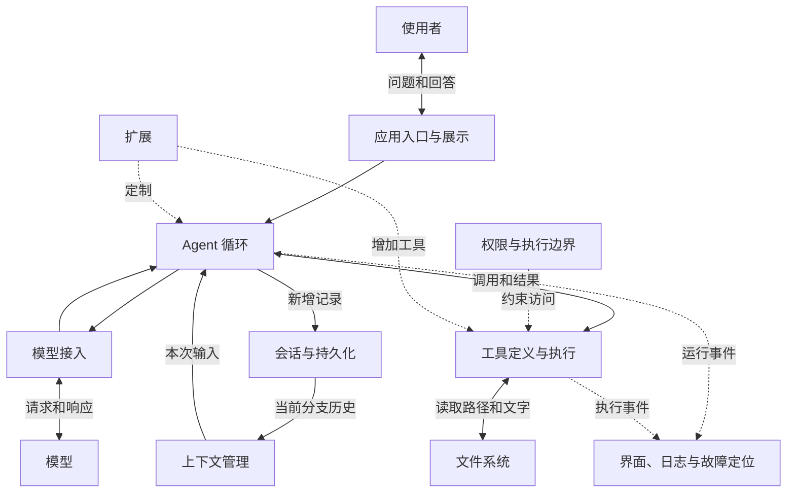

# 第一篇 · Pi 为什么存在，Agent Harness 在做什么

## 学习路线

1. **宏观理解**。能用“读取 `lesson.txt`”解释使用者、模型、Pi、工具各自做什么。
2. **核心运行过程**。能按顺序讲清一次任务如何经历模型请求、工具调用、工具结果和最终回答。
3. **关键模块**。理解模型接入、上下文、会话、权限和事件怎样支撑这个过程。
4. **最小代码**。逐步学习 JavaScript 的对象、函数、异步等待和错误处理，写一个教学版读文件循环。
5. **源码阅读**。把教学代码与本地 Pi 实现对应起来，找到关键入口、数据结构和分支。
6. **动手实验**。写一个简单扩展，观察读取成功、文件不存在、参数错误和中途停止，并练习解释设计取舍。

## 1. 从一个具体任务开始

**以下文件内容、对话和运行结果均为教学示例。**

假设你的电脑里有一个叫 `lesson.txt` 的文件，内容如下。

> 今天学习 Agent。模型提出工具调用，程序执行工具。

你向助手提出：

> 请读取 lesson.txt，告诉我文件里的内容。

完成这件事需要两类能力。一类是理解“读取文件”“告诉我内容”的意思，并组织回答。另一类是实际找到文件、检查能否读取、取得其中的文字。前一类由模型承担，后一类要靠能访问文件的程序。

### 单独调用一次模型 API 能做到什么

API 可以先理解成程序向另一个服务提交请求的入口。例如，你写的程序向模型服务发送一条问题，服务返回模型生成的内容。这就是一次模型 API 调用。

如果只发送问题，模型拿到的是文件名。它可以理解你的意图、请你贴出文件内容，或者生成读取文件的代码。要基于文件回答，模型需要实际的文件文字。如果应用的需求始终是“读取指定文件并回答”，程序可以先读取文件，再把文字和问题一起发给模型，一次请求就可能完成任务。

Agent 让程序能够根据模型给出的下一步建议，执行操作并把结果交回模型。例如，第一次读取失败后，模型可以请求查找文件。文件太长时，模型可以请求继续读取后面的部分。后续动作由中间结果影响。

### 如果允许模型使用工具，还要写哪些程序

工具是一段可以执行具体操作的程序。这里的 `read` 工具负责读取文件。程序会先把工具说明交给模型，告诉它 `read` 能做什么，以及调用时需要提供文件路径。路径是读文件所需的信息，称为参数。

模型随后可能返回一个意思相当于“请调用 `read`，路径为 `lesson.txt`”的请求。模型用约定的数据格式给出操作名称和参数，这就是**工具调用**。

程序收到调用后，还需要完成以下工作。

1. 识别返回内容里有一次工具调用。
2. 找到名叫 `read` 的工具，检查路径参数是否符合要求。
3. 执行读取，将文字或错误记录为工具结果。
4. 结合原问题和工具结果，再次请求模型。
5. 处理下一次工具调用或交付回答，并处理取消与失败。

### Pi 承担什么，开发者还要负责什么

Pi 是一个可扩展的 Agent Harness，也提供可以直接使用的终端应用。终端是通过文字和命令与程序交互的窗口。Pi 已经提供模型接入、运行循环、内置读取工具、会话管理和结果展示。直接用 Pi 读取普通文本时，使用者通常可以复用这些能力。[Pi 官方运行说明](https://pi.dev/docs/latest/how-pi-works)

- **使用者**提出目标，希望知道文件内容。
- **模型**根据收到的信息选择操作，并根据工具结果组织回答。
- **Pi**安排模型请求、处理工具调用、记录结果并推进任务。
- **工具**访问文件系统，取得文字或返回错误。文件系统是操作系统管理文件和目录的机制。

如果要做一个公司内部文档助手，开发者仍然要决定怎样识别使用者、哪些文档允许读取、哪些内容可以发送给模型，以及如何判断回答符合业务要求。如果资料来自公司内部服务，开发者还可能需要编写对应的工具。

**理解练习。** 模型已经生成了读取文件的代码，为什么你还需要检查它有没有真正读到文件？先区分“生成一段文字”和“程序执行操作”，再指出实际内容来自哪里。

## 2. Pi 的背景与发展

本篇的官方资料核对日期为 2026 年 11 月 7 日。源码对应本地 `pi` 目录的提交 `085c84e98e7f4c950f2be606466fff4f75d8fe7c`。下文用版本号标明发布事实，用“本文分析”标明对设计影响的解释。

### 2025 年 11 月 · 作者希望掌握模型输入与运行过程

**作者公开表述。** Mario Zechner 在 2025 年 11 月 30 日的文章中回顾了自己使用其他编程助手的经历。他偏好简单、可预测的工具，认为系统提示和工具频繁变化会影响已有工作流，也希望能够检查与模型的交互、控制模型输入、读取有文档说明的会话记录，并用同一个 Agent 核心构建其他界面。[作者文章](https://mariozechner.at/posts/2025-11-30-pi-coding-agent/)

**系统提示**是程序给模型的基础说明，比如“可以使用这些工具”。**上下文**是模型这次生成时能够参考的信息，例如系统提示、你的问题、工具定义和此前返回的文件内容。同一句问题配上不同的工具说明或历史消息，模型可能选择不同的操作。

**可核实事实。** 作者当时介绍了四个主要部分。`pi-ai` 统一模型接口，`pi-agent-core` 处理运行循环，`pi-tui` 支撑终端界面，`pi-coding-agent` 将这些能力组合成终端应用。文章还记录了简短的系统提示和少量默认工具。2025 年 11 月 30 日是文章发布日期，项目开始开发及首次公开的精确日期在本篇资料中未核实。[作者对初期结构的说明](https://mariozechner.at/posts/2025-11-30-pi-coding-agent/)

**本文分析。** 把模型接入、循环和界面拆开，开发者就能分别追查“发了什么给模型”“执行了哪个工具”和“界面如何显示”，也能把运行核心用于其他应用。当前仓库还有 Durable 等模块。本篇聚焦终端应用经由 `packages/coding-agent` 和 `packages/agent` 运行的路径。[当前官方仓库](https://github.com/earendil-works/pi)

### 2026 年 1 月 · 会话变成可分支的记录

**版本事实。** 2026 年 1 月 2 日的 v0.31.0 引入会话树。每条记录用编号指向上一条记录，使用者可以回到之前的位置继续，并保留原来的历史。[v0.31.0 发布记录](https://github.com/earendil-works/pi/releases/tag/v0.31.0)

**本文分析。** 比如先读取 `lesson.txt`，再请模型总结，然后回到读取结果之后改问“逐句解释”。“总结”和“逐句解释”可以形成两条分支。即使两条分支保存在同一个会话文件中，Pi 也要按当前分支选择下一次请求使用的历史。[会话与上下文文档](https://pi.dev/docs/latest/sessions)

### 2026 年 1 月 · 扩展统一了增加工具与介入运行的方式

**版本事实。** 2026 年 1 月 5 日的 v0.35.0 将原有 hooks 和自定义工具合并到 extensions 系统。扩展是加载到 Pi 中，为它增加或调整能力的程序。Hook 可以先理解为预留的介入位置，例如“每次准备执行工具时，先检查路径”。[v0.35.0 发布记录](https://github.com/earendil-works/pi/releases/tag/v0.35.0)

**本文分析。** 增加“查询课程信息”与介入已有的 `read` 执行，是两种不同的需求。统一的扩展入口让开发者可以在同一个扩展中表达这两类需求。[扩展文档](https://pi.dev/docs/latest/extensions)

### 2026 年 9 月 · MCP、工具搜索和 codemode 加入内置扩展

**版本事实。** 早期作者文章将 MCP 列为没有内置的能力。2026 年 9 月 29 日，v0.99.0 将 MCP、工具搜索和 codemode 作为内置扩展加入。MCP 是连接外部工具服务的协议。工具搜索帮助发现尚未直接展示给模型的工具。Codemode 可以执行模型编写的程序来组织工具操作。[作者的早期说明](https://mariozechner.at/posts/2025-11-30-pi-coding-agent/#no-mcp-support) · [v0.99.0 发布记录](https://github.com/earendil-works/pi/releases/tag/v0.99.0) · [当前 MCP 文档](https://pi.dev/docs/latest/mcp)

**本文分析。** 这段变化说明默认能力需要按版本核对。发布记录能确认功能何时进入产品，资料不足以确认每项变化背后的动机。学习基本循环时，可以把 MCP 当作工具来源之一，先看内置 `read` 怎样接入同一条执行路径。

**理解练习。** 如果一篇旧教程说 Pi 没有内置 MCP，你会怎样核对它适用于哪个版本？分别说说作者文章、发布记录和当前文档能回答什么。

## 3. Harness 如何组织一次任务

Agent Harness 是围绕模型组织信息、执行动作和管理运行状态的程序。**Agent** 在本系列中指能够围绕目标，利用模型提出操作、利用工具执行操作，并根据结果继续工作的系统。应用还负责使用者如何输入、如何看到结果，以及登录和业务流程等问题。Pi 同时提供 Harness 和终端应用，其他应用也可以调用它提供的能力。[Pi 官方文档](https://pi.dev/docs/latest)

使用者的自然语言指令经过两次转换。Pi 先把指令和工具说明交给模型。模型根据这些信息生成结构化工具调用。Pi 再按工具名称和参数调用实际程序。模型有时可能选错路径，程序也可能在错误的工作目录里寻找正确的文件名。把这两个阶段分开，才容易判断一次失败发生在哪里。

在没有排队消息或额外定制的常见路径上，模型返回工具调用，Pi 执行后继续请求模型。模型返回普通回答且没有工具调用时，运行通常结束。这个结束条件只说明程序停止自动发起后续请求。判断任务是否正确完成，还需要检查实际工具结果和回答。

如果 `lesson.txt` 不存在，工具会报告失败。Pi 可以把错误包装成工具结果，并用 `isError: true` 标记它。模型看到错误后，可以说明情况，也可以尝试别的操作，具体行为取决于模型输入、可用工具和运行规则。模型服务请求失败属于另一条路径。核心循环遇到模型响应的错误或中止状态会结束该次核心运行，外层会话可按错误类型和配置安排重试。排队消息和定制结束规则也会影响是否继续。[本地 `runLoop()` 与工具执行逻辑](../../pi/packages/agent/src/agent-loop.ts) · [本地会话重试逻辑](../../pi/packages/coding-agent/src/core/agent-session.ts)

**理解练习。** 模型说“我已经读到文件”，你会查看什么来确认？先找实际工具调用和对应的执行结果，再看工具读取的路径是否符合任务要求。

## 4. Harness 知识地图

这张图按信息、动作和记录的流向组织。分类参考 Pi 官方文档中的循环、上下文、会话、接口、扩展与权限，并把模型接入和工具执行拆开，便于追踪读文件过程。实线表示信息流，虚线表示约束、观测或定制。[分类依据](https://pi.dev/docs/latest/how-pi-works)

### 4.1 模型接入

通用 Harness 需要把问题、历史和工具定义转换成所选模型服务接受的请求，并把返回内容转换成程序能处理的形式。提供模型服务的一方通常称为 provider。Pi 由 `pi-ai` 承担这项工作，`models.ts` 中的 `streamSimple()` 是相关入口。这里的流式返回指结果分批到达，界面可以边接收边显示。

入门先区分模型返回的文字、工具调用和请求错误。认证、网络协议和流式解析可以后学。[本地模型接入源码](../../pi/packages/ai/src/models.ts)

### 4.2 Agent 循环

循环从模型接入层取得回复，把其中的操作请求交给工具执行层，再将结果送入下一次请求。Pi 的 `pi-agent-core` 对应 `packages/agent`，其中 `Agent.prompt()` 接收输入，`runLoop()` 控制运行推进。

优先理解一次任务可以包含多次模型请求，以及程序按什么条件继续和结束。排队消息、多个工具同时执行和自定义结束条件可以后学。[本地 Agent 入口](../../pi/packages/agent/src/agent.ts) · [本地运行循环](../../pi/packages/agent/src/agent-loop.ts)

### 4.3 工具定义与执行

工具定义告诉模型操作的名字、用途和参数要求。工具执行程序接收参数并完成动作。**JSON Schema** 可以先理解为机器能够检查的参数说明书，例如 `path` 是必填字段，且值应当是文字。一个路径符合格式，文件仍可能不存在。

Pi 的 `prepareToolCall()` 按名称找工具并检查参数，`executePreparedToolCall()` 执行工具并处理异常，`createToolResultMessage()` 将调用编号、内容和错误标记等组装成结果。内置 `read` 的定义和执行代码由 `createReadToolDefinition()` 提供。

优先区分工具定义、调用参数、执行程序和结果。复杂参数、图片结果与并行调度可以后学。[本地工具执行层](../../pi/packages/agent/src/agent-loop.ts) · [本地 `read` 工具](../../pi/packages/coding-agent/src/core/tools/read.ts)

### 4.4 上下文管理

上下文管理选择模型本次能参考的信息。第一次请求可能只带问题、基础说明和工具定义。读取之后，下一次请求需要纳入调用和对应结果，模型才能根据实际文字回答。历史变长时，Pi 可以用摘要替换后续请求中的部分旧消息，这叫上下文压缩。原始会话条目仍可保留。Pi 的 `buildSessionContext()` 负责从会话记录构建相关上下文。

优先用“这段文字是否进入本次请求”判断模型是否具备回答所需的信息。摘要质量、上下文限额和缓存可以后学。[官方会话与上下文说明](https://pi.dev/docs/latest/sessions) · [本地上下文构建源码](../../pi/packages/coding-agent/src/core/session-manager.ts)

### 4.5 会话与持久化

会话是围绕一段交流保存的记录。持久化是把记录写入存储，让程序退出后仍能恢复。Pi 的持久化会话使用 JSONL 文件，可以先理解成一行一条结构化记录。会话可以存放多个分支，上下文构建会选取当前分支。源码中的 `SessionManager` 管理会话，`appendMessage()` 添加消息记录。

入门先能解释恢复对话需要程序保存并重新加载历史。存储格式、迁移与损坏恢复可以后学。[会话文件格式](https://pi.dev/docs/latest/session-format) · [本地会话管理源码](../../pi/packages/coding-agent/src/core/session-manager.ts)

### 4.6 权限与执行边界

参数检查确认路径字段是否合格。业务授权决定用户是否应当读取这个文件。执行边界决定运行中的程序实际上能访问什么。进程是一个正在运行的程序实例，Pi 的工具与扩展通常使用 Pi 进程的权限。项目信任机制决定某些项目资源是否会加载。文件访问边界还取决于操作系统和运行环境。

优先区分提示里的要求、程序中的判断和环境实施的隔离。容器、凭据管理和网络访问控制可以后学。[Pi 官方安全说明](https://pi.dev/docs/latest/security)

### 4.7 事件与运行观测

事件是程序发出的运行通知，例如“开始执行 `read`”或“执行结束，结果表示失败”。界面可以根据事件显示进度，日志也可以保留事件供之后检查。Pi 提供模型消息和工具执行事件，以及供其他程序读取的结构化事件输出。

优先练习定位失败阶段。找不到工具时检查名称和工具配置，文件不存在时检查路径和工作目录，工具结果正确但回答偏离时检查模型实际收到的输入与最终生成内容。完整监控与性能统计可以后学。[Pi 官方事件流文档](https://pi.dev/docs/latest/json)

### 4.8 扩展与应用入口

应用入口负责接收问题和展示结果。Pi 提供终端界面，也提供让其他程序创建和控制会话的接口。扩展可以注册新工具，也可以介入已有流程，例如为课程助手加一个查询课程工具，或在执行 `read` 前检查路径。

入门先能说清扩展在什么时候触发、收到什么信息、改变哪个动作。第一个扩展可以只注册一个容易验证的工具，之后再学习自定义界面和复杂事件处理。[官方运行说明](https://pi.dev/docs/latest/how-pi-works) · [官方扩展文档](https://pi.dev/docs/latest/extensions)

## 5. 用 `lesson.txt` 走一遍整张图

以下为教学示例。假设模型支持工具调用，`read` 可用，工作目录里有较短的 `lesson.txt`，任务执行中没有插入其他消息。

1. 你提交“请读取 lesson.txt，告诉我文件里的内容”。Pi 的会话层接收输入。
2. Pi 将基础说明、相关历史、问题和工具定义发送给模型。此时请求还没有包含文件文字。
3. 模型提出“调用 `read`，路径为 `lesson.txt`”。
4. Pi 按名称找到工具，检查参数，再根据工作目录解析文件路径。工具从文件系统取得文字。
5. Pi 将文字放进带有调用编号的工具结果。下一次模型请求包含此次操作和对应结果。
6. 模型根据文字组织回答。此处假设它没有再提出工具调用，运行随之结束。

如果文件不存在，第 4 步会产生读取错误。第 5 步交回模型的是失败结果。模型据此可能告诉你文件不存在，也可能提出新的操作。

本地源码中，`createAgentSession()` 负责组合会话所需的部件，`AgentSession.prompt()` 接收会话输入并协调底层运行。接下来再沿 `runLoop()`、`prepareToolCall()`、`executePreparedToolCall()` 和 `createToolResultMessage()` 追踪每一步。[本地组装入口](../../pi/packages/coding-agent/src/core/sdk.ts) · [本地会话入口](../../pi/packages/coding-agent/src/core/agent-session.ts) · [本地运行循环](../../pi/packages/agent/src/agent-loop.ts)

## 6. 面试追问

以下是根据阅读源码、解释机制和排查故障所需能力推导的练习题。

1. **基础理解。一次读文件任务为什么可能请求模型两次？**  
   第一次模型提出读取操作，第二次根据实际工具结果回答。追问能否只请求一次时，说明应用可以先按固定流程读文件，再把文字放进首次请求。答题依赖模型与工具的职责划分。
2. **实现细节。工具结果为什么要带调用编号？**  
   如果模型同时请求读取两个文件，程序和模型都需要知道每段结果来自哪次操作。答题依赖工具调用与工具结果的对应关系。编号如何跨不同模型接口转换，留到消息结构篇。
3. **实现细节。参数验证通过，为什么仍可能读取失败？**  
   格式检查只能确认路径字段满足规则。排查时继续检查工作目录、文件是否存在和进程权限。答题依赖参数规则和运行环境的区别。
4. **工程取舍。为什么不把全部会话历史都发给模型？**  
   模型的输入容量有限，长请求也消耗时间和费用。选择当前分支和使用摘要可以减少输入，摘要可能丢失细节。答题依赖会话与上下文的区别。如何计算输入规模和评估摘要质量，留到上下文管理篇。
5. **工程取舍。工具成功，能说明任务已经正确完成吗？**  
   读取成功只说明某次操作完成，还要确认读的是目标文件，回答忠实于内容。答题依赖执行结果和用户目标的区别。自动检查任务质量还需要学习测试数据、预期行为和评价标准。

## 7. 合上文档后，用自己的话回答

1. 只把 `lesson.txt` 这个名字发给模型，为什么它不知道文件内容？
2. 模型提出 `read` 请求之后，到真正读出文字之间需要哪些动作？
3. Pi 帮开发者承担了什么？公司内部文档助手还需要开发者设计什么？
4. Agent 循环通常什么时候继续、什么时候停止？停止后还需要验证什么？
5. 会话记录和本次模型上下文有什么区别？
6. 文件不存在时，错误怎样成为模型后续判断的依据？
7. “参数符合格式”“业务允许读取”“操作系统能读”分别回答什么问题？
8. 为什么描述 Pi 的 MCP 支持时需要说明版本？

下一篇沿同一个例子展开请求、工具调用、工具结果与最终回答的数据。先对照成功和文件不存在两条路径，再引入阅读最小代码所需的对象、函数和异步等待。
