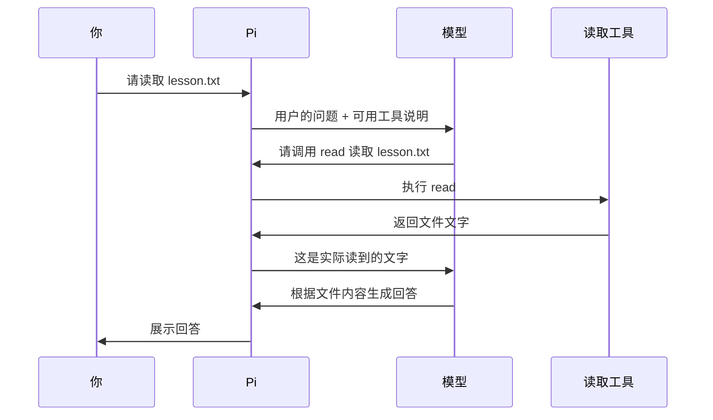

# 第一篇 · Pi 为什么存在，Agent Harness 在做什么

## 学习路线

1. **宏观理解**。能用“读取 `lesson.txt`”解释使用者、模型、Pi、工具各自做什么。
2. **核心运行过程**。能按顺序讲清一次任务如何经历模型请求、工具调用、工具结果和最终回答。
3. **关键模块**。理解模型接入、上下文、会话、权限和事件怎样支撑这个过程。
4. **最小代码**。逐步学习 JavaScript 的对象、函数、异步等待和错误处理，写一个教学版读文件循环。
5. **源码阅读**。把教学代码与本地 Pi 实现对应起来，找到关键入口、数据结构和分支。
6. **动手实验**。写一个简单扩展，观察读取成功、文件不存在、参数错误和中途停止，并练习解释设计取舍。

## 1. 从一个具体任务开始

**以下文件内容、对话和运行结果均为教学示例。**

假设你的电脑里有一个叫 `lesson.txt` 的文件，内容如下。

> 今天学习 Agent。模型提出工具调用，程序执行工具。

你向助手提出：

> 请读取 lesson.txt，告诉我文件里的内容。

完成这件事需要两类能力。一类是理解“读取文件”“告诉我内容”的意思，并组织回答。另一类是实际找到文件、检查能否读取、取得其中的文字。前一类由模型承担，后一类要靠能访问文件的程序。

### 单独调用一次模型 API 能做到什么

API 是程序请求另一个服务的入口。你的程序发一条问题，模型服务返回一段生成内容，这就是一次模型 API 调用。

这次调用的输入，只有你放进去的文字。模型读不到硬盘上的文件：只发问题时，它手里的 `lesson.txt` 只是个文件名，不是文件内容。因此它只能理解你的意图、请你贴出内容，或生成一段读取文件的代码——而代码只是文字，文件并未被真正读取。

模型也没有执行能力。工具调用只是程序与模型协作的一种方式：模型输出“调用哪个工具、传什么参数”的文字，程序识别后去执行，再把结果交回模型。真正读取文件、访问网络的，始终是程序。

### 一次调用不够时，才需要 Agent

如果“读哪个文件”在调用前就已确定——比如程序写死读 `lesson.txt`——程序可以先把文件读出来，再把文字和问题一起发过去，一次请求通常就能完成。前提是：读什么由程序事先定好，不依赖模型判断。

但现实任务往往不满足这个前提：第一次读取可能失败，文件可能太长只读到一半，读到的内容可能指向另一个文件。下一步做什么取决于上一步的结果，无法提前写死。这时“一次调用”就要变成循环：模型给出下一步建议，程序执行，再把结果交回模型，直到能回答。这个循环就是 Agent，下一节展开它具体怎么跑。

### 如果允许模型使用工具，还要写哪些程序

工具是一段可以执行具体操作的程序。这里的 `read` 工具负责读取文件。程序会先把工具说明交给模型，告诉它 `read` 能做什么，以及调用时需要提供文件路径。路径是读文件所需的信息，称为参数。

模型随后可能返回一个意思相当于“请调用 `read`，路径为 `lesson.txt`”的请求。模型用约定的数据格式给出操作名称和参数，这就是**工具调用**。

**程序收到调用后，还需要完成以下工作。**

1. **识别返回内容里有一次工具调用。**
2. **找到名叫 `read` 的工具，检查路径参数是否符合要求。**
3. **执行读取，将文字或错误记录为工具结果。**
4. **结合原问题和工具结果，再次请求模型。**
5. **处理下一次工具调用或交付回答，并处理取消与失败。**

这**五步**都是普通程序逻辑，不需要模型参与执行；Pi 这类 Agent Harness 已经把它们封装好了。

### Pi 承担什么，开发者还要负责什么

Harness 原意是“挽具”：马具本身不产生力气，但没有它，马的力气拉不动车。Pi 也一样——它不产生智能，只负责把模型的输出接到真实操作上。“可扩展”指你可以给它加新工具，不用改它内部的运行循环。Pi 同时提供一个开箱可用的终端应用（用文字和命令交互的窗口）。[Pi 官方运行说明](https://pi.dev/docs/latest/how-pi-works)

还是用读 `lesson.txt` 这件事，看四个角色各干什么：

- **你（使用者）**：提出“读取 lesson.txt 并告诉我内容”；没有你，任务不会发生。
- **模型**：读懂问题、决定调用 `read`、拿到结果后组织回答；没有它，程序不知道读什么、怎么答。
- **Pi**：发请求、执行工具调用、把结果带回模型、循环到能回答；没有它，这些代码全要你自己写。
- **工具 `read`**：真正打开文件、返回文字或错误；没有它，模型手里永远只有文件名。

Pi 提供的五块能力，正好对应上一节列的五步：

| Pi 的能力 | 白话解释                       | 对应步骤    |
| ------ | -------------------------- | ------- |
| 模型接入   | 替你发请求、收回复，不用手写接口格式         | 第 4 步   |
| 运行循环   | “模型建议 → 程序执行 → 再问模型”的循环    | 第 4、5 步 |
| 内置读取工具 | 现成的 `read`                 | 第 2、3 步 |
| 会话管理   | 记住之前发过什么，第二次请求才能带上原问题和文件内容 | 第 4 步   |
| 结果展示   | 把最终回答显示在终端                 | 第 5 步   |

那开发者还要做什么？一句话：**Pi 负责“怎么跑”，开发者负责“为谁跑、能碰什么、算不算跑对”。** 以公司文档助手为例：识别使用者是谁；哪些文档允许读取、哪些内容可以发给模型；如何判断回答符合业务要求；如果资料在公司内部系统里，就写一个新工具注册给 Pi。

**理解练习。** 模型已经生成了读取文件的代码，为什么你还需要检查它有没有真正读到文件？

**参考答案。** 生成代码时，模型交给你的只是一段文字。假设你只提供了文件名，就要检查 Pi 有没有实际执行读取，以及工具结果有没有返回 `lesson.txt` 的文字。代码本身不会自动运行。

## 2. Pi 在 Agent 生态中的位置

当大模型应用从「收到问题就生成回答」扩展到「根据执行结果选择下一步」，开发者就需要反复处理同一类工程问题，比如调用模型、执行工具、保存历史和恢复会话。模型与工具反复交互的模式在 Pi 出现前就已有公开实践。**Pi 的作用是把这些运行能力做成可复用的开源组件。** 你可以直接在终端里用它，也可以把同一套能力接进自己的应用。[Anthropic 对 Agent 循环的早期说明](https://www.anthropic.com/research/building-effective-agents) · [Pi 官方仓库](https://github.com/earendil-works/pi) · [Pi 的嵌入接口](https://pi.dev/docs/latest/sdk)

**OpenClaw 的早期版本展示了这种复用。** 它曾把 Pi 的会话和工具循环接进自己的应用，同时自行处理聊天渠道，并提供发消息等专用工具。就像把终端里的「读 `lesson.txt`」搬到聊天窗口里，接收和展示消息的部分换了，向模型提问、执行工具、交回结果的过程可以复用。OpenClaw 后来的内置运行机制由项目自己维护，因此这里说的是早期集成案例。[OpenClaw v2026.2.6 集成文档](https://github.com/openclaw/openclaw/blob/v2026.2.6/docs/pi.md#overview) · [OpenClaw 当前运行架构](https://github.com/openclaw/openclaw/blob/main/docs/concepts/agent-runtimes.md)

**对开发者来说，Pi 的优势是复用之后还能改、还能查。** 例如，把读本地文件改成查课程资料，可以注册一个新工具，复用原有循环。换模型服务时，模型接入层处理接口差异。读文件失败时，可以查看模型请求调用哪个工具、传了什么路径，以及执行返回了什么。这样，你可以把工作集中在课程助手特有的功能上，也能用运行记录判断错误发生在哪一步。[Pi 扩展文档](https://pi.dev/docs/latest/extensions) · [模型接入文档](https://pi.dev/docs/latest/models) · [事件输出文档](https://pi.dev/docs/latest/json)

**理解练习。** 如果你把终端里的读文件助手搬进聊天应用，哪些工作可以交给 Pi，哪些仍由应用处理？

**参考答案。** Pi 可以接收应用传入的消息，并负责请求模型、执行读取工具、将工具结果交回模型和管理会话。聊天应用通常负责对接聊天平台、识别发送者、选择对应的 Pi 会话、落实文件访问权限，以及把回答发送回对应的聊天窗口。这里要区分“从聊天平台收取消息”和“接收输入并交给 Agent 处理”：Pi 可以承担后者；直接使用 Pi 的终端应用时，接收用户输入和展示回答也都由 Pi 提供。[Pi 接口说明](https://pi.dev/docs/latest/how-pi-works) · [Pi SDK 文档](https://pi.dev/docs/latest/sdk)

**飞书示例。** 假设你要开发一个飞书文件助手，读取的是助手运行环境中的本地文件。用户在飞书里发送“读取 lesson.txt”，一种常见的处理流程是：

1. **应用接收飞书消息事件。** 取得消息正文、发送者和聊天信息。
2. **应用确定身份、权限和会话。** 根据发送者及聊天场景选择对应的 Pi 会话，并确保读取工具只能访问该用户获准读取的文件；权限检查需要在实际执行读取时生效。
3. **应用把消息交给 Pi。** 例如调用 `session.prompt("读取 lesson.txt")`，让对应会话开始处理输入。
4. **Pi 推进 Agent 循环。** 请求模型、执行读取工具、把读取结果交回模型，再由模型生成回答。
5. **应用把回答发回飞书。** 取得 Pi 产生的回答，通过飞书接口发送到原来的聊天窗口。

这是一种职责划分。聊天平台接入代码和 Pi 可以放在同一个程序里；把它们分开讲，是为了说明从哪里收到消息、由谁处理消息，以及最后通过哪个渠道回复。

## 3. Harness 如何组织一次任务

假设你对助手说：

> 请读取 lesson.txt，告诉我文件里的内容。

从收到这句话到给出回答，整个过程如下：

1. **Pi 收到你的问题，把问题和可用工具的说明发给模型。** 工具说明会告诉模型：有一个叫 `read` 的工具，提供文件路径就能读取文件。
2. **模型决定下一步做什么。** 它发现需要先读取文件，于是返回一个工具调用，意思是：“请执行 `read`，读取 `lesson.txt`。”此时，文件还没有被读取。
3. **Pi 根据这个调用执行工具。** `read` 工具实际打开文件，把读到的文字返回给 Pi。
4. **Pi 把工具结果交给模型。** 这次模型拿到的信息包括：你原来的问题、刚才的读取操作，以及实际读出的文件文字。
5. **模型根据文件文字生成回答。** 如果它没有再要求调用工具，且没有其他待处理的输入或定制的继续条件，这次运行通常就结束了。

Pi 负责把这些步骤连接起来：请求模型、执行模型提出的工具调用、把结果交回模型，并根据模型的下一次回复继续运行。这就是这里所说的 **Harness 的工作**。模型、Harness 和工具组合起来，形成了本系列讨论的 **Agent 系统**：它能够围绕目标采取行动，再根据行动结果决定下一步。Pi 同时提供 Harness 和终端应用，其他应用也可以调用它提供的能力。[Pi 官方运行说明](https://pi.dev/docs/latest/how-pi-works)

模型每次回答时能参考的全部信息，叫作**上下文**。在这个例子里，上下文包括你的问题、工具说明和已经读到的文件文字等。其中，程序给模型的基础要求，例如“根据实际读取结果回答”，叫作**系统提示**。

**如果文件不存在，会发生什么？** `read` 工具会返回“文件不存在”这样的错误。Pi 把错误作为工具结果交给模型，模型再决定如何回应：它可能告诉你读取失败，也可能在有合适工具的情况下继续查找。工具返回的错误，也可以成为模型决定下一步的信息。

如果是模型服务本身没有响应，请求就无法按上述流程继续，需要由程序处理失败或重试。想进一步了解这两类失败怎样处理，可以查看[本地 `runLoop()` 与工具执行逻辑](../../pi/packages/agent/src/agent-loop.ts)和[本地会话重试逻辑](../../pi/packages/coding-agent/src/core/agent-session.ts)。

**运行结束，只说明这轮处理停下来了。** 要确认任务完成得对，还要检查工具实际读取了哪个文件、返回了什么，以及最终回答是否与读取结果一致。

**理解练习。** 模型说“我已经读到文件”，你会查看什么来确认？

**参考答案。** 查看 `read` 工具实际读取的路径，以及它返回的结果。确认读的是 `lesson.txt`，结果里确实有文件文字，再检查回答是否与这些文字一致。

## 4. Harness 知识地图

上一节走完了一次读文件任务。这一节沿着同一个例子，理解 Harness 需要哪些能力：先看任务怎样执行，再看信息怎样准备和保存，最后看权限、进度和扩展怎样配合。[Pi 官方运行说明](https://pi.dev/docs/latest/how-pi-works)

### 4.1 主流程：Pi 怎样连接模型和工具？

你提出“读取 lesson.txt”后，消息按下面的顺序传递。图从上往下读，每个箭头表示一次请求或结果的传递。读取工具由 Pi 调用，这里单独画出来，方便看清实际读取发生在哪一步。

这条流程里有三个需要理解的部分：

- **模型接入**：负责与模型服务通信，把问题、历史和工具说明转换成服务接受的请求，再把回复转换成程序能处理的形式。
- **工具定义与执行**：先告诉模型有哪些工具、需要提供什么参数；模型提出调用后，Pi 检查参数并执行对应工具。例如，`read` 需要文件路径，执行后返回文件文字或错误。
- **Agent 循环**：负责安排先后顺序。收到工具调用就执行工具，再带着结果请求模型；如果模型还要求操作，就继续。

比如模型先读到一份目录，又决定读取目录中的另一份文件，这个过程就会再走一轮。因此，一次用户任务可能包含多次模型请求。

想对照代码时，可以分别查看[模型接入源码](../../pi/packages/ai/src/models.ts)、[Agent 入口](../../pi/packages/agent/src/agent.ts)、[运行循环与工具执行](../../pi/packages/agent/src/agent-loop.ts)和[内置 `read` 工具](../../pi/packages/coding-agent/src/core/tools/read.ts)。

### 4.2 上下文：Pi 每次把什么交给模型？

第一次请求时，Pi 可以把这些信息交给模型。下面用文字概括，实际请求会使用模型服务要求的数据格式。

> 基础要求：根据实际读取结果回答。  
> 用户问题：读取 lesson.txt。  
> 可用工具：read，可以根据路径读取文件。

第二次请求时，还要加入：

> 模型刚才要求读取 lesson.txt。  
> 工具实际返回的文件文字。

准备这些信息，就是**上下文管理**。你可以把上下文理解为“模型这次作答时手边的资料”。文件文字进入这份资料后，模型才有依据回答。排查回答出错时，可以先问：模型这次请求中，是否真的包含了它需要的资料？

历史变长时，Pi 可以用摘要替换后续请求中的部分旧消息，这叫**上下文压缩**。这样能减少每次发送的信息，但摘要可能遗漏细节。[官方会话与上下文说明](https://pi.dev/docs/latest/sessions) · [本地上下文构建源码](../../pi/packages/coding-agent/src/core/session-manager.ts)

### 4.3 会话与持久化：对话怎样记住、怎样恢复？

假设你接着问：

> 刚才那个文件的第二句话是什么意思？

程序需要保留前面的交流，才能知道“刚才那个文件”指什么。这些保存下来的问题、回答、工具调用和结果，构成了**会话记录**。

把记录写到磁盘，关闭程序后还能重新加载，就是**持久化**。Pi 的持久化会话使用 JSONL 文件，可以先理解成一行保存一条记录。

会话与上下文的关系是：**会话记录保存交流过程；上下文管理从记录中准备本次请求需要的信息。** 会话可以保留原始记录，而本次发送给模型的内容可能已经包含摘要。如果对话有多个分支，Pi 会沿当前分支准备上下文。[会话文件格式](https://pi.dev/docs/latest/session-format) · [本地会话管理源码](../../pi/packages/coding-agent/src/core/session-manager.ts)

### 4.4 配套能力：怎样控制访问、查看进度和增加功能？

除了推进任务和保存信息，实际应用还需要处理以下工作：

| 能力      | 用读文件的例子理解                                                                                              |
| ------- | ------------------------------------------------------------------------------------------------------ |
| 权限与执行边界 | 检查用户是否获准读取，以及运行 Pi 的程序实际能否打开这个文件。[安全说明](https://pi.dev/docs/latest/security)                           |
| 事件与运行观测 | 发出“开始读取”“读取结束”等通知，让界面显示进度，也让日志留下排查问题的线索。[事件流文档](https://pi.dev/docs/latest/json)                       |
| 扩展      | 给 Pi 增加能力，例如加入“查询课程资料”的工具，或在读取前增加权限检查。[扩展文档](https://pi.dev/docs/latest/extensions)                    |
| 应用入口    | 接收问题并展示回答。直接用 Pi 时可以是终端；接入飞书时，也可以由飞书接入代码收取消息，再交给 Pi 处理。[接口说明](https://pi.dev/docs/latest/how-pi-works) |

权限这里可以用三个具体问题区分：

- **参数检查**：传入的文件路径是不是符合工具要求，例如是否提供了文字类型的路径？
- **业务授权**：这位用户是否获准读取这个文件？应用需要把这项规则落实到实际读取检查中。
- **执行边界**：运行 Pi 的程序实际上能否打开这个文件？这取决于操作系统权限和运行环境的限制。

例如，路径格式正确，也不能说明用户获准读取；即使用户获准读取，操作系统也可能拒绝访问。在提示中写“只能读课程目录”可以指导模型，但实际限制文件访问，还需要程序检查或运行环境的约束。

查看运行记录时，也可以沿主流程逐步定位：模型有没有提出 `read` 调用？工具有没有真正执行？返回的是文件文字还是错误？模型后续收到的资料里有没有这段文字？这些问题分别对应任务中的不同阶段。

## 5. 用 `lesson.txt` 串起这些能力

以下为教学示例。假设模型支持工具调用，`read` 可用，工作目录里有较短的 `lesson.txt`，任务执行中没有插入其他消息。

1. 你提交“请读取 lesson.txt，告诉我文件里的内容”。Pi 的会话层接收输入。
2. Pi 将基础说明、相关历史、问题和工具定义发送给模型。此时请求还没有包含文件文字。
3. 模型提出“调用 `read`，路径为 `lesson.txt`”。
4. Pi 按名称找到工具，检查参数，再根据工作目录解析文件路径。工具从文件系统取得文字。
5. Pi 将文字放进带有调用编号的工具结果。下一次模型请求包含此次操作和对应结果。
6. 模型根据文字组织回答。此处假设它没有再提出工具调用，运行随之结束。

如果文件不存在，第 4 步会产生读取错误。第 5 步交回模型的是失败结果。模型据此可能告诉你文件不存在，也可能提出新的操作。

本地源码中，`createAgentSession()` 负责组合会话所需的部件，`AgentSession.prompt()` 接收会话输入并协调底层运行。接下来再沿 `runLoop()`、`prepareToolCall()`、`executePreparedToolCall()` 和 `createToolResultMessage()` 追踪每一步。[本地组装入口](../../pi/packages/coding-agent/src/core/sdk.ts) · [本地会话入口](../../pi/packages/coding-agent/src/core/agent-session.ts) · [本地运行循环](../../pi/packages/agent/src/agent-loop.ts)

本文所用的本地源码对应 `pi` 提交 `085c84e98e7f4c950f2be606466fff4f75d8fe7c`。官方资料核对日期为 2026 年 11 月 7 日。

## 6. 面试追问

以下是根据阅读源码、解释机制和排查故障所需能力推导的练习题。

1. **基础理解。一次读文件任务为什么可能请求模型两次？**  
   因为第一次请求时，模型可能只收到“读取 lesson.txt”这句话，还没有文件内容。它先提出“调用 `read` 读取这个文件”，Pi 随后执行工具，把读出的文字放进第二次请求，模型才据此回答。也就是说，**第一次由模型决定要做什么，第二次让模型根据执行结果回答**。如果应用事先已经确定要读哪个文件，也可以先读取，再把文件文字和问题一起交给模型，这样通常一次模型请求就够了。
2. **实现细节。工具结果为什么要带调用编号？**  
   调用编号用来把一次工具调用和它的结果对应起来。例如，模型要求读取 `lesson.txt` 和 `homework.txt`，两次调用都使用 `read` 工具，只看工具名称无法区分。假设两次调用的编号分别是 `call_1` 和 `call_2`，那么返回的结果也要分别带上对应编号，这样程序和模型就能知道：哪段文字来自读取 `lesson.txt` 的操作，哪段结果来自读取 `homework.txt` 的操作。即使其中一次读取失败，错误也能对应到正确的调用。具体怎样在消息中传递编号，留到消息结构篇。
3. **实现细节。参数验证通过，为什么仍可能读取失败？**  
   参数验证通常只检查传入的数据是否符合工具要求。例如，`read` 要求提供文字类型的 `path`，那么 `path: "lesson.txt"` 可以通过这项检查。但执行时，文件仍可能不存在；Pi 也可能从错误的工作目录查找文件，或者运行 Pi 的程序没有读取权限。因此，**“参数符合要求”和“文件能被成功打开”是两件事**。读取失败时，要结合工具返回的错误，检查实际查找的路径、文件是否存在，以及程序是否有权访问。
4. **工程取舍。为什么不把全部会话历史都发给模型？**  
   模型一次能接收的信息量有限，发送更多历史也会增加时间和费用。因此，程序可以保存完整的会话记录，每次请求时再准备需要交给模型的内容。例如，程序保存了之前的 100 轮对话，这次可以把较早的对话整理成摘要，再加上最近几轮对话发送给模型，原始记录仍然保留着。这里，**会话记录是程序保存的交流过程，上下文是本次实际交给模型参考的信息**；保存完整记录，不代表每次请求都要发送完整记录。不过，摘要可能遗漏细节，需要根据任务决定哪些内容应当保留原文。如何计算输入规模和评估摘要质量，留到上下文管理篇。
5. **工程取舍。工具成功，能说明任务已经正确完成吗？**  
   不能。工具成功只说明它完成了这次具体操作。例如，你要求读取课程目录里的 `lesson.txt`，工具却成功打开了另一个目录下的同名文件；虽然读取成功，仍然没有完成你的要求。即使读对了文件，模型也可能在回答中遗漏关键内容，或加入文件里没有的信息。因此，需要依次确认：**读的是不是用户指定的文件、工具实际返回了什么、最终回答是否准确回应了用户的问题**。这些都符合要求，才能判断任务完成得对。怎样用测试样例自动检查这些问题，后续再展开。

## 7. 合上文档后，用自己的话回答

1. 你对模型说“读取 lesson.txt”，为什么这还不能让它知道文件内容？程序还需要做什么？
2. 模型已经提出“调用 read 读取 lesson.txt”，文件就被读出来了吗？接下来 Pi 和工具分别要做什么？
3. 如果要做一个接入飞书的公司文档助手，哪些工作可以交给 Pi，哪些还需要开发者实现？
4. 读文件过程中，Pi 什么时候会再次请求模型，什么时候通常会停止？停止后，怎样确认任务完成得对？
5. 程序保存了之前的 100 轮对话，这次是否必须全部发给模型？会话记录和本次上下文分别是什么？
6. read 工具返回“lesson.txt 不存在”后，Pi 会把什么交给模型？模型接下来可能怎样回应？
7. `path: "lesson.txt"` 通过了参数检查，是否说明用户获准读取，而且程序一定能打开它？还需要分别检查什么？
8. OpenClaw 早期把 Pi 接进聊天应用时，复用了哪些能力，又自行实现了哪些工作？

展开查看参考答案

1. 模型收到的只是一个文件名，这条消息没有包含文件文字，也不会自动让模型访问你的硬盘。程序需要实际读取文件，再把读出的文字交给模型。在本文的流程中，模型先提出 `read` 调用，Pi 执行读取后，把工具结果放进下一次模型请求，模型才有依据回答。

2. 还没有。模型提出工具调用时，只是给出了要做的操作和参数。Pi 接下来按名称找到 `read`，检查路径参数，并根据工作目录确定 `lesson.txt` 的实际位置；读取工具再打开文件，返回文字或错误。Pi 收到结果后，还要把它交给模型，模型才能继续处理。

3. Pi 可以接收应用传入的问题，负责请求模型、执行工具、把结果交回模型和管理会话。开发者需要实现飞书消息接入，识别发送者、选择对应会话，把问题交给 Pi，并把回答发回原来的聊天窗口。开发者还要规定并实际检查谁能读哪些文档、哪些内容可以发给模型，以及怎样判断回答合格。如果文档在公司内部系统中，还需要提供查询该系统的工具。

4. 在正常处理过程中，模型提出工具调用后，Pi 执行工具，再把结果放进下一次请求；模型如果还要求操作，这个过程就继续。模型给出回答且没有工具调用，也没有其他待处理输入或定制的继续条件时，运行通常停止。但停止不等于做对：还要核对读取路径是不是用户指定的文件、工具实际返回了什么，以及回答是否准确回应了用户的问题。例如，读到了另一个目录里的同名文件，即使工具报告成功，也没有完成要求。

5. 不必全部发送。会话记录是程序保存的交流过程，包括问题、回答、工具调用和结果；本次上下文是这次实际交给模型参考的信息，还可以包括系统提示和工具说明。例如，程序可以保留 100 轮对话的原始记录，这次只发送较早对话的摘要和最近几轮交流，以减少输入量、时间和费用。不过，摘要可能遗漏细节，任务需要的关键原文仍要保留在本次上下文中。

6. Pi 会把“lesson.txt 不存在”作为这次 `read` 调用的结果交给模型。模型看到的是一次读取失败，因此不能据此声称已经读到了文件文字。它可能告诉用户文件不存在、请用户确认路径，也可能在有合适工具且规则允许时尝试查找文件。具体下一步取决于模型拿到的信息和可用工具，读取失败后不一定立刻结束任务。

7. 不能。参数检查通过，只说明提供的路径符合工具要求，例如 `path` 的值是文字。还要检查业务授权：这位用户是否获准读取这个文件；以及实际访问条件：文件是否存在、路径是否正确、运行 Pi 的程序是否有读取权限。例如，某个文件确实存在，程序也能打开，但用户没有获准读取，应用仍应阻止访问；反过来，用户获准读取，操作系统也可能拒绝程序访问。

8. 在本文介绍的早期集成中，OpenClaw 复用了 Pi 的模型请求、工具循环和会话能力，自行处理聊天渠道，并提供发送消息等专用工具。换成读文件的例子，就是把“用户从哪里提问、回答发回哪里”接到自己的聊天应用中，继续复用 Pi 处理问题、调用工具和管理会话的过程。这说明应用可以在现有 Harness 上实现自己的入口和业务功能。

下一篇沿同一个例子展开请求、工具调用、工具结果与最终回答的数据。先对照成功和文件不存在两条路径，再引入阅读最小代码所需的对象、函数和异步等待。
