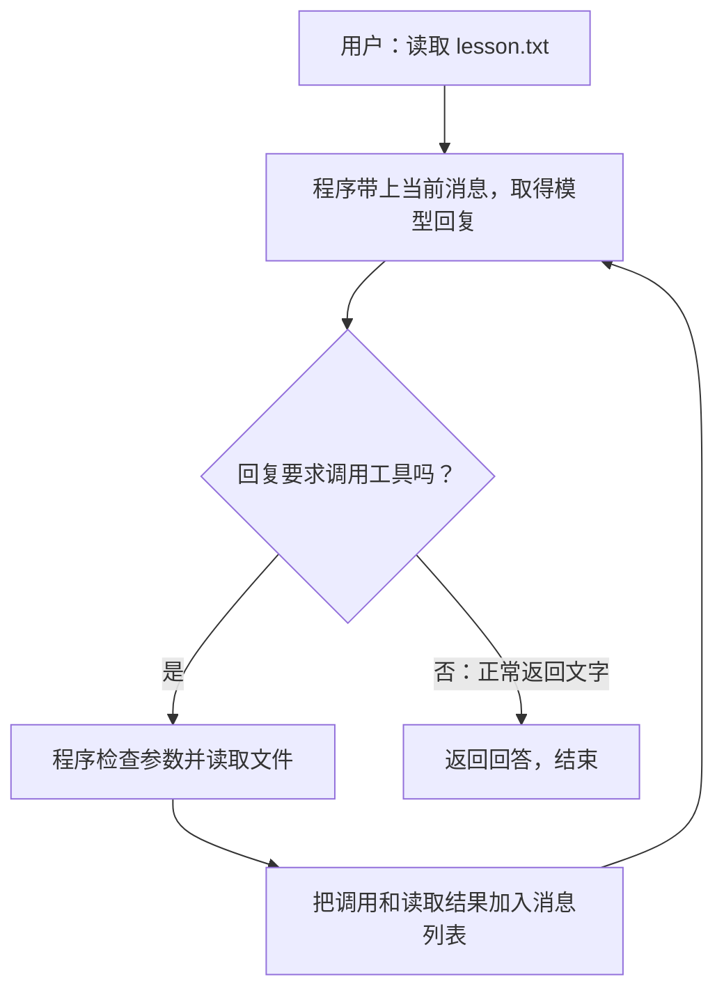
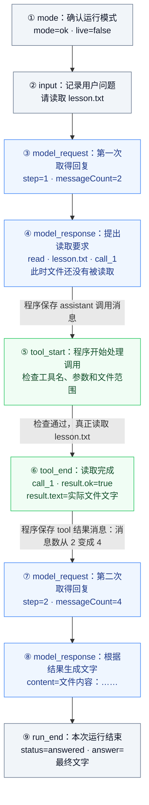

# 第三篇 · 跑通一个最小 Agent 循环

学习路线：[[00-Agent开发实习学习路线与项目规划]]。上一篇：[[02-messages-and-tool-calls]]。

下一篇：[[04-reliable-tool-execution|怎样让工具调用可靠地执行？]]。

> [!tip] 这篇怎么学
> **先看流程 → 运行示例 → 对照日志 → 改一个停止条件。** 正文只讲核心机制；准备步骤、完整代码、语法和联网配置放在文末，按需展开。你可以借助 AI 操作，但要先判断预期，再用运行结果检查。

## 1. 这次只做一件事：让程序读取文件，再回答

任务仍然是：**“请读取 lesson.txt，告诉我文件里的内容。”**

第二篇已经看过消息怎样传递。这一篇把它们接成一个真正能运行的小程序：

**取得模型回复 → 如果要求工具，就由程序执行 → 把结果加入消息 → 再次取得回复。**

你需要掌握三个核心点：

| 核心点      | 先记住这句话                          |
| -------- | ------------------------------- |
| **消息列表** | 保存这次对话；再次请求模型时，把它需要看到的调用和结果一起带上 |
| **工具执行** | 模型提出“读哪个文件”，程序检查参数并实际读取         |
| **循环控制** | 程序判断继续、回答或报错，并控制最多请求几次          |

**先用模拟模型练习，不需要 API 密钥。** 模拟模型是一个按预设规则返回消息的函数：先要求读取，再根据结果生成文字。它没有自主理解任务的能力；文件读取、消息追加和停止判断则都真实执行。

本次先验证“这些步骤接对了吗”。真实模型是否选对工具、回答是否可靠，需要联网后另行验证。

## 2. 先看懂：为什么读一次文件，要请求两次模型？

因为**模型提出读取要求时，还没有拿到这次工具实际读出的文字**。程序必须先执行，再把结果交回去。



这张图只画主流程，错误和请求次数上限稍后单独看。离线实验中的“模型回复”由模拟函数提供。

正常读取时，实际顺序是：

| 顺序      | 谁做什么？                             | 消息发生什么变化？               |
| ------- | --------------------------------- | ----------------------- |
| ① 第一次请求 | 模拟模型提出 `read` 调用，参数是 `lesson.txt` | 保留这条 assistant 调用消息     |
| ② 执行工具  | 程序检查参数，再真正读取文件                    | 加入 tool 结果，用调用编号对应刚才的要求 |
| ③ 第二次请求 | 把更新后的消息交给模拟模型                     | 它这次才能根据读取结果生成文字         |
| ④ 返回回答  | 程序确认是正常文字回复                       | 保存回复并结束                 |

**只在终端打印读取结果，模型不会因此自动看到它；必须把结果放进下一次请求的消息中。** 真实 DeepSeek 工具调用也需要由应用执行工具、回传结果。[官方工具调用示例](https://api-docs.deepseek.com/guides/tool_calls/)

## 3. 先运行成功的情况，再沿日志回看

先打开 [[#附录 A：准备文件与完整代码|附录 A]]，准备 `lesson.txt` 和 `mini-agent.mjs`，然后回到这里。**先复制完整示例运行，不必提前读懂所有代码。**

在这两个文件所在目录打开 PowerShell，执行：

```powershell
node mini-agent.mjs ok
```

日志每行都是一条记录，`type` 表示发生了什么。第一次只按下面顺序找，不必读懂所有字段：

```text
model_request   step: 1       第一次取得回复
model_response               提出读取要求
tool_start                   进入工具处理
tool_end        ok: true     实际读取成功
model_request   step: 2       带着读取结果，再次取得回复
model_response               根据结果生成文字
run_end         answered     返回了回答
```

上面是**省略字段的顺序说明**，终端实际输出为 JSON。第一条日志还会显示 `mode: "ok"`、`live: false`，表示没有请求远程模型。

这次检查三件事：

- `tool_end` 中的文字，是否等于 `lesson.txt` 的内容？
- 是否出现两次 `model_request`，分别为第 1、2 步？
- 第二次请求的 `messageCount` 是否为 4？它包含 system 要求、user 问题、assistant 调用、tool 结果。

再把 `lesson.txt` 改成另一句普通文字，重跑一次。回答应随文件变化；模拟函数预设了处理顺序，没有写死文件内容。

### 实际例子：逐条读懂你这次运行的日志

下面保留了你提供的实际运行记录，并解释全部字段。需要详细对照时展开；快速阅读可以直接进入第 4 节。

**九条日志对应的流程：**



读图时看三点：**蓝色**表示与模拟模型交换消息，**绿色**表示程序处理工具；沿箭头从上到下，就是你终端中的日志顺序。两次 model_request 都调用模拟函数，没有请求远程模型。

第一次请求的 2 条消息是 **system + user**；保存调用和结果后，第二次变成 **system + user + assistant 调用 + tool 结果**，共 4 条。调用与结果都对应 **call_1**。这张图只描述本次正常读取，错误与达到上限的情况见第 4 节。


> [!example]- 展开九条实际日志与逐步解释
> 这次实际运行的是：
>
> ```powershell
> node mini-agent.mjs ok
> ```
>
> 整个过程是：**用户提出问题 → 模拟模型要求读取 → 程序真正读取 → 结果交回模拟模型 → 生成回答。**
>
> 下面按出现顺序解释你提供的九条日志。每条都是一个 JSON 对象；优先看 `type`，它是事件名称，告诉你程序走到了哪里。较长的日志只调整了缩进，字段和值保留原样。
>
> **① mode：确认运行模式**
>
> ```json
> {"type":"mode","mode":"ok","live":false}
> ```
>
> - `mode: "ok"`：选择正常读取实验，是模式名称。
> - `live: false`：使用模拟函数，没有请求真实 DeepSeek。
>
> 所以这次**文件读取是真的，模型选择工具和组织回答的步骤由预设函数模拟。**
>
> **② input：记录用户问题**
>
> ```json
> {"type":"input","question":"请读取 lesson.txt，告诉我文件里的内容。"}
> ```
>
> `question` 是本次任务。后续提出读取要求、执行工具和返回文字，都是为了处理这个问题。
>
> **③ model_request：第一次取得回复**
>
> ```json
> {"type":"model_request","step":1,"messageCount":2}
> ```
>
> - `step: 1`：第一次调用“取得模型回复”的函数。
> - `messageCount: 2`：当前传入的消息有两条。
>
> | 角色 | 消息内容 |
> | --- | --- |
> | system | 程序设定的要求：先读取，再根据结果回答；失败时不编造 |
> | user | 用户问题：读取 lesson.txt，告诉我内容 |
>
> 日志名虽然是 model_request，但**本次调用的是模拟函数，没有发生远程模型请求。**
>
> **④ model_response：提出工具调用，尚未读取文件**
>
> ```json
> {
>   "type": "model_response",
>   "step": 1,
>   "message": {
>     "role": "assistant",
>     "content": null,
>     "tool_calls": [
>       {
>         "id": "call_1",
>         "type": "function",
>         "function": {
>           "name": "read",
>           "arguments": "{\"path\":\"lesson.txt\"}"
>         }
>       }
>     ]
>   }
> }
> ```
>
> | 字段 | 在这次任务中是什么意思？ |
> | --- | --- |
> | 外层 `type: "model_response"` | 取得了一条回复 |
> | `step: 1` | 这是第一次请求对应的回复 |
> | `message` | 回复的具体内容 |
> | `role: "assistant"` | 这条消息来自助手这一方 |
> | `content: null` | 这次没有普通回答文字 |
> | `tool_calls` | 工具调用列表，这次只有一个调用 |
> | `id: "call_1"` | 这次调用的编号，后续用来对应结果 |
> | 内层 `type: "function"` | 采用函数工具调用的形式 |
> | `function.name: "read"` | 要求使用名为 read 的工具 |
> | `function.arguments` | 希望交给工具的参数 |
>
> 把整条消息翻译成人话就是：**“先请程序执行 read，读取 lesson.txt；这次操作编号为 call_1。”**
>
> 参数看起来是：
>
> ```text
> "{\"path\":\"lesson.txt\"}"
> ```
>
> 因为 `arguments` 本身是一段字符串，里面的双引号用 `\"` 表示。程序用 JSON.parse 解析后，才得到可以读取 path 字段的对象：
>
> ```json
> {"path":"lesson.txt"}
> ```
>
> **这里还没有打开文件，只是提出了读取要求。**
>
> **⑤ tool_start：程序开始处理这次调用**
>
> ```json
> {"type":"tool_start","id":"call_1","name":"read"}
> ```
>
> `id` 仍然是 call_1，说明处理的是刚才那次操作；`name` 表示要处理的工具。
>
> 程序会先检查工具名、参数和允许的文件名，再实际读取。**tool_start 只表示开始处理，不代表读取成功。**
>
> **⑥ tool_end：取得真实读取结果**
>
> ```json
> {
>   "type": "tool_end",
>   "id": "call_1",
>   "result": {
>     "ok": true,
>     "text": "今天学习 Agent。模型提出工具调用，程序执行工具。"
>   }
> }
> ```
>
> - `tool_end`：这次工具处理结束。
> - `id: "call_1"`：结果属于刚才那次调用。
> - `result.ok: true`：工具处理成功。
> - `result.text`：从文件实际读到的文字。
>
> **这一条才证明本次确实成功读取了文件。** 这里的 ok 是执行结果；第一条 mode 中的 ok 是实验名称，含义不同。
>
> **⑦ model_request：带着工具结果，再次取得回复**
>
> ```json
> {"type":"model_request","step":2,"messageCount":4}
> ```
>
> `step: 2` 表示第二次取得回复。消息数为什么从 2 变成了 4？因为程序增加了调用消息和工具结果：
>
> | 顺序 | 角色 | 此时消息中保存了什么？ |
> | --- | --- | --- |
> | 1，原有 | system | 先读取、再回答等基础要求 |
> | 2，原有 | user | 读取 lesson.txt 的问题 |
> | 3，新增 | assistant | call_1：要求 read 读取 lesson.txt |
> | 4，新增 | tool | call_1 的执行结果：成功，以及文件文字 |
>
> 工具结果消息会带 `tool_call_id: "call_1"`，对应第三条消息中的调用编号。这个字段未单独打印在你提供的日志里，但完整程序会将它加入消息列表。
>
> **终端打印了结果，不代表模型自动看见了结果。程序必须把它加入下一次传入的消息。**
>
> **⑧ model_response：根据结果生成回答**
>
> ```json
> {
>   "type": "model_response",
>   "step": 2,
>   "message": {
>     "role": "assistant",
>     "content": "文件内容：今天学习 Agent。模型提出工具调用，程序执行工具。"
>   }
> }
> ```
>
> 这次 `content` 中有回答文字，也没有再提出工具调用。程序因此可以返回回答并结束循环。
>
> 模拟函数是从工具结果中取出 text，再加上“文件内容：”，没有写死文件里的那句话。换掉 lesson.txt 的内容，回答也应随之变化。
>
> **⑨ run_end：记录整个运行的结束状态**
>
> ```json
> {
>   "type": "run_end",
>   "status": "answered",
>   "answer": "文件内容：今天学习 Agent。模型提出工具调用，程序执行工具。"
> }
> ```
>
> - `run_end`：本次运行结束。
> - `status: "answered"`：收到了正常文字回答。
> - `answer`：最终返回的文字。
>
> 最后把三个判断分开：
>
> | 要判断什么？ | 看哪里？ |
> | --- | --- |
> | 文件是否读取成功？ | tool_end 中的 result.ok |
> | 程序是否返回了回答？ | run_end 中的 status |
> | 回答是否满足任务？ | 对照用户问题、工具结果与最终回答 |
>
> 这次日志显示：文件读取成功，最终回答包含读取到的文字，符合本次“读取并告诉我内容”的要求。这个结论限于这次离线实验，不代表真实模型的工具选择与回答质量已经验证。

## 4. 主动制造失败：先判断哪里出错

依次运行下面四条命令，每次先预测：**有没有执行读取？会继续生成回答，还是停止？**

| 命令                                | 发生什么？                | 日志里重点看什么？                          |
| --------------------------------- | -------------------- | ---------------------------------- |
| `node mini-agent.mjs missing`     | 要求读取未创建的 missing.txt | `tool_end` 的 `ok` 为 false；随后说明读取失败 |
| `node mini-agent.mjs bad-args`    | 把文件路径填成数字 7          | 报“path 必须是文字”；实际读取函数不会被调用          |
| `node mini-agent.mjs loop`        | 每次都要求继续读取，不给最终回答     | 四次模型请求后出现 `limit`，程序停止             |
| `node mini-agent.mjs model-error` | 模拟取得模型回复时失败          | 出现 `model_error`，没有 `tool_start`   |

练习目录中不要创建 `missing.txt`，否则第一项就不再是“文件不存在”实验。

**文件读取失败与模型请求失败，要分开看：**

- **工具失败**：已经收到调用，可以把“参数错误、文件不存在”等作为这次调用的结果交回去；还有请求额度时，继续生成说明。
- **模型请求失败**：没有正常取得回复，本例停止并报告请求阶段的错误，不能编造文件读取结果。

> [!important] answered 不等于任务成功
> `answered` 在本例中只表示“收到了正常文字回答”。missing 模式也会返回它，因为“读取失败”同样是一种回答。**是否读到文件，要看工具结果；是否满足用户要求，还要核对回答与证据。**

loop 和 model-error 模式的退出码为 1，是这两个实验的预期结果。本篇不自动重试；哪些错误值得重试，留到第四篇。

## 5. 回看代码：先只找这三个位置

在附录 A 的完整代码中搜索下面三个位置，把刚才的日志与程序对应起来：

| 搜索内容                                | 它在做什么？                     | 你要能解释的问题            |
| ----------------------------------- | -------------------------- | ------------------- |
| `await askModel(messages)`          | 用当前消息取得下一条回复               | 第二次传进去的消息，比第一次多了什么？ |
| `await executeRead(call, readText)` | 检查工具参数并实际读取，再追加对应的 tool 消息 | 模型提出调用后，为什么还要执行这一步？ |
| `maxSteps = 4`                      | 默认最多发起四次模型请求               | 如果模型一直要求工具，谁来让它停下？  |

> [!faq]- 三个问题的参考答案
> **① 第二次传进去的消息，比第一次多了什么？**
>
> 多了两条消息：
>
> - **assistant 消息**：记录模型提出的工具调用，例如“用 read 读取 lesson.txt”，调用编号为 `call_1`。
> - **tool 消息**：记录程序实际执行的结果，例如读取到的文件文字，并通过 `tool_call_id: "call_1"` 对应那次调用。
>
> 所以消息从 **2 条变成 4 条**：原来的 system 要求和 user 问题，加上 assistant 调用和 tool 结果。第二次取得回复时，才能根据读取结果回答。
>
> **② 模型提出调用后，为什么还要执行这一步？**
>
> 因为**提出调用只是一个操作要求，文件还没有被读取**。`executeRead(...)` 会检查工具名称、参数和允许的文件名，再真正读取文件。程序随后把成功或失败的结果加入消息，交给下一次模型请求。
>
> 可以理解为：**模型说“请读这个文件”，程序负责真正去读。** 本篇离线模式中的调用要求由模拟函数提出。
>
> **③ 如果模型一直要求工具，谁来让它停下？**
>
> 由**程序中的循环限制**决定停止。本例的 `maxSteps = 4` 表示最多发起四次模型请求；第四轮处理完后，即使模型还想继续，程序也不会发起第五次请求，而是返回 `limit`。
>
> 限制的是**模型请求次数**，生成最终回答的那次请求也计数。只在提示词中要求“不要无限循环”不够，程序需要实际执行停止限制。

`messages.push(assistant)` 保存模型提出的操作；后面的 `messages.push({ role: "tool", ... })` 保存工具实际结果。**调用与结果通过编号对应，两条消息都要保留。**

不用现在逐行读完 `main`、参数声明和辅助检查。不认识某种写法时，再查 [[#附录 B：用到再查的语法与字段|附录 B]]。

## 6. 亲手改一次：把请求上限从 4 改成 1

先预测：正常读取需要两次模型请求。如果只允许一次，会发生什么？

在完整代码的 `runAgent` 参数中，把：

```javascript
maxSteps = 4
```

改成：

```javascript
maxSteps = 1
```

保存 `mini-agent.mjs`，再运行：

```powershell
node mini-agent.mjs ok
```

预期结果是：**第一次取得读取要求，工具也读取成功；但没有额度发起第二次请求，因此返回 limit，没有最终回答。**

这说明上限限制的是**模型请求次数**，最终回答那次也计数。它不是工具总数、token 数，也不是总运行时间。实验后把默认值恢复为 4。

可以让 AI 帮你找到修改位置，但先写下自己的预测，再检查日志是否一致。

## 7. 到这里，怎样判断可以进入项目？

合上正文，尝试回答：

1. 模型提出 `read` 调用时，文件已经被读了吗？
2. 工具结果为什么要加入消息，而不能只打印在终端？
3. 文件读取失败和模型请求失败，为什么处理不同？
4. `maxSteps = 1` 时为什么可能读到了文件，却没有最终回答？
5. 模拟模式跑通，能证明真实模型会正确选择工具吗？

> [!faq]- 对照答案
> 1. 还没有，程序检查参数并执行读取后，才有实际结果。
> 2. 下一次请求只能使用传入的内容；终端输出不会自动变成模型输入。
> 3. 工具失败有一条已知调用可对应；请求失败不能证明任何文件事实。
> 4. 第一次请求后执行了工具，但生成最终回答还需要第二次请求，额度已用完。
> 5. 不能。模拟函数按预设规则返回消息，只能用于验证被覆盖的程序流程。

完成正常、missing、bad-args、loop、model-error 的观察，再做完上限修改实验，就可以开始候选项目：把“读取教学文件”换成“只读查询业务记录”。同步学习第四篇的可靠性、少量固定测试和权限边界，不必等全部章节读完。

**使用真实模型前，再完成附录 C 的配置与验证。** 形成项目能力和评测结论时，要清楚区分模拟实验与真实模型结果。

---

## 附录 A：准备文件与完整代码

> [!example]- 第一步：准备环境和两个文件
> 使用 Node.js 22 或更新版本。在 PowerShell 执行 `node --version` 检查；无法识别 node 时，先安装运行环境并重新打开终端。
>
> 在一个新的练习目录准备：
>
> ```text
> 练习目录/
>   lesson.txt
>   mini-agent.mjs
> ```
>
> **mini-agent.mjs 是什么文件？**
>
> 它是一个 **JavaScript 代码文件**。`mini-agent` 是自己起的名字，表示“小型 Agent”；`.mjs` 是扩展名，明确告诉 Node.js：**按模块方式运行这个文件。**
>
> “模块”可以理解为：把代码分到不同文件中，让它们互相使用。常用两个关键词：
>
> - `import`：引入其他模块提供的功能。
> - `export`：把当前文件的功能提供给其他文件。
>
> 例如完整代码中的这一行：
>
> ```javascript
> import { readFile } from "node:fs/promises";
> ```
>
> 意思是：从 Node.js 自带的文件模块中，引入 `readFile` 读取功能。
>
> 本篇使用 `.mjs`，可以明确采用 `import`、`export` 这套模块写法，无需额外配置模块类型。[Node.js 模块与扩展名说明](https://nodejs.org/api/packages.html#determining-module-system)
>
> 运行 `node mini-agent.mjs ok` 时，`node` 负责执行程序，`mini-agent.mjs` 是要运行的文件，`ok` 是传给程序的参数，用来选择正常读取模式。
>
> lesson.txt 写入：
>
> ```text
> 今天学习 Agent。模型提出工具调用，程序执行工具。
> ```
>
> 不创建 missing.txt。mini-agent.mjs 复制下方完整代码，复制时不要带代码围栏。文件名保留 .mjs，避免误存成 .txt。
>
> 不需要安装 npm 包。文件读取默认相对于脚本位置；运行命令时，在练习目录打开终端即可。[Node.js 文件读取](https://nodejs.org/api/fs.html)、[内置 fetch](https://nodejs.org/api/globals.html#fetch)

> [!example]- 完整可运行代码
>
> ```javascript
> import { readFile } from "node:fs/promises";
> import { resolve } from "node:path";
> import { fileURLToPath } from "node:url";
>
> const READ_TOOL = {
>   type: "function",
>   function: {
>     name: "read",
>     description: "读取教学文件，仅允许 lesson.txt 或 missing.txt。",
>     parameters: {
>       type: "object",
>       properties: { path: { type: "string", enum: ["lesson.txt", "missing.txt"] } },
>       required: ["path"],
>       additionalProperties: false,
>     },
>   },
> };
>
> async function executeRead(call, readText) {
>   try {
>     if (call.function.name !== "read") throw new Error("不支持的工具");
>     let args;
>     try { args = JSON.parse(call.function.arguments); }
>     catch { throw new Error("参数不是合法 JSON"); }
>     if (!args || Array.isArray(args) || typeof args.path !== "string") {
>       throw new Error("path 必须是文字");
>     }
>     if (Object.keys(args).length !== 1) throw new Error("只接受 path 参数");
>     if (!["lesson.txt", "missing.txt"].includes(args.path)) {
>       throw new Error("仅允许 lesson.txt 或 missing.txt");
>     }
>     const text = await readText(args.path);
>     return { ok: true, text };
>   } catch (error) {
>     return { ok: false, error: error.message };
>   }
> }
>
> export async function runAgent({
>   question, askModel, maxSteps = 4, log = () => {},
>   readText = (path) => readFile(new URL(path, import.meta.url), "utf8"),
> }) {
>   const messages = [
>     { role: "system", content: "先用 read 读取指定文件，再根据结果回答。ok 为 false 时说明失败，不编造内容。" },
>     { role: "user", content: question },
>   ];
>   const seenIds = new Set();
>   log({ type: "input", question });
>
>   for (let step = 1; step <= maxSteps; step++) {
>     log({ type: "model_request", step, messageCount: messages.length });
>     let assistant;
>     let calls;
>     try {
>       const choice = await askModel(messages);
>       assistant = choice.message;
>       calls = assistant?.tool_calls ?? [];
>       if (assistant?.role !== "assistant" || !Array.isArray(calls)) {
>         throw new Error("模型回复格式不符合约定");
>       }
>       const expectedReason = calls.length > 0 ? "tool_calls" : "stop";
>       if (choice.finish_reason !== expectedReason) {
>         throw new Error(`模型未正常完成：${choice.finish_reason}`);
>       }
>       if (calls.length === 0 && (typeof assistant.content !== "string" || !assistant.content.trim())) {
>         throw new Error("模型没有返回回答文字");
>       }
>       for (const call of calls) {
>         if (typeof call.id !== "string" || !call.id || seenIds.has(call.id) ||
>             call.type !== "function" || typeof call.function?.name !== "string" ||
>             typeof call.function.arguments !== "string") {
>           throw new Error("工具调用缺少必要字段或编号重复");
>         }
>         seenIds.add(call.id);
>       }
>     } catch (error) {
>       log({ type: "model_error", step, error: error.message });
>       return { status: "model_error", error: error.message, messages };
>     }
>
>     messages.push(assistant);
>     log({ type: "model_response", step, message: assistant });
>     if (calls.length === 0) {
>       return { status: "answered", answer: assistant.content, messages };
>     }
>     for (const call of calls) {
>       log({ type: "tool_start", id: call.id, name: call.function.name });
>       const result = await executeRead(call, readText);
>       messages.push({ role: "tool", tool_call_id: call.id, content: JSON.stringify(result) });
>       log({ type: "tool_end", id: call.id, result });
>     }
>   }
>   log({ type: "limit", maxSteps });
>   return { status: "limit", error: "达到模型请求次数上限", messages };
> }
>
> export function createMockModel(mode = "ok") {
>   return async (messages) => {
>     if (mode === "model-error") throw new Error("模拟模型服务连接失败");
>     const last = messages.at(-1);
>     if (last.role === "tool" && mode !== "loop") {
>       const result = JSON.parse(last.content);
>       const content = result.ok ? `文件内容：${result.text}` : `读取失败：${result.error}`;
>       return { finish_reason: "stop", message: { role: "assistant", content } };
>     }
>     let args = JSON.stringify({ path: mode === "missing" ? "missing.txt" : "lesson.txt" });
>     if (mode === "bad-args") args = JSON.stringify({ path: 7 });
>     if (mode === "bad-json") args = "{";
>     const id = `call_${messages.filter((message) => message.role === "assistant").length + 1}`;
>     return {
>       finish_reason: "tool_calls",
>       message: { role: "assistant", content: null, tool_calls: [{
>         id, type: "function",
>         function: { name: mode === "unknown-tool" ? "other" : "read", arguments: args },
>       }] },
>     };
>   };
> }
>
> export async function askDeepSeek(messages, options = {}) {
>   const apiKey = options.apiKey ?? process.env.DEEPSEEK_API_KEY;
>   const model = options.model ?? process.env.DEEPSEEK_MODEL ?? "deepseek-flash";
>   if (!apiKey) throw new Error("未配置 DEEPSEEK_API_KEY");
>   const fetchImpl = options.fetchImpl ?? fetch;
>   const response = await fetchImpl("https://api.deepseek.com/chat/completions", {
>     method: "POST",
>     headers: { "Content-Type": "application/json", Authorization: `Bearer ${apiKey}` },
>     body: JSON.stringify({
>       model, messages, tools: [READ_TOOL], stream: false,
>       thinking: { type: "disabled" }, max_tokens: 1024,
>     }),
>     signal: AbortSignal.timeout(options.timeoutMs ?? 30000),
>   });
>   if (!response.ok) throw new Error(`模型服务 HTTP ${response.status}`);
>   const data = await response.json();
>   const choice = data.choices?.[0];
>   if (!choice) throw new Error("模型服务没有返回 choice");
>   return choice;
> }
>
> async function main() {
>   const mode = process.argv[2] ?? "ok";
>   const modes = ["ok", "missing", "bad-args", "bad-json", "loop", "model-error", "unknown-tool", "live"];
>   if (!modes.includes(mode)) throw new Error("未知模式，请检查运行命令");
>   console.log(JSON.stringify({ type: "mode", mode, live: mode === "live" }));
>   const target = mode === "missing" ? "missing.txt" : "lesson.txt";
>   const result = await runAgent({
>     question: `请读取 ${target}，告诉我文件里的内容。`,
>     askModel: mode === "live" ? askDeepSeek : createMockModel(mode),
>     log: (event) => console.log(JSON.stringify(event)),
>   });
>   console.log(JSON.stringify({ type: "run_end", status: result.status, answer: result.answer, error: result.error }));
>   if (result.status !== "answered") process.exitCode = 1;
> }
>
> if (process.argv[1] && resolve(process.argv[1]) === fileURLToPath(import.meta.url)) {
>   main().catch((error) => { console.error(error.message); process.exitCode = 1; });
> }
> ```

复制后回到 [[#3. 先运行成功的情况，再沿日志回看|第 3 节]] 开始运行。上面的完整代码保留原有功能；正文中的单行片段仅用于查找和修改，不要重复粘贴进脚本。

## 附录 B：用到再查的语法与字段

> [!info]- JavaScript 语法：先按用途理解
>
> | 写法 | 本篇里怎样理解？ |
> | --- | --- |
> | `const messages = []` | 准备消息列表；可以继续向这个列表追加内容 |
> | `messages.push(...)` | 在列表末尾加一条记录 |
> | `async` / `await` | 声明异步函数；在函数中等读取或请求完成后，再使用结果 |
> | `JSON.parse(...)` | 把 JSON 文字转成程序中的值；这里用于解析工具参数 |
> | `JSON.stringify(...)` | 把数据转成 JSON 文字；这里用于工具结果和日志 |
> | `try / catch` | 尝试操作；操作抛出错误时，进入错误处理 |
> | `assistant?.tool_calls ?? []` | 尝试取得调用列表；没有时使用空列表，后续仍检查格式 |
> | `for (...)` | 按条件重复执行；外层限制请求次数，内层逐个处理工具调用 |
> | `runAgent({ ... })` | 把问题、取得回复的函数等，放进一个对象传给循环 |
> | `new Set()` | 记录已经用过的调用编号，防止重复编号混淆 |
> | `export` / 文件末尾判断 | 允许函数被导入检查；直接运行脚本时，才启动命令行任务 |
>
> 定义函数不等于执行函数。看到 `executeRead(...)` 被调用，才开始走里面的检查与读取步骤。

> [!info]- 消息字段与状态：不要一次背完
>
> | 名称 | 含义 |
> | --- | --- |
> | `messages` | 本次循环累积的消息；不是跨进程自动保存的长期记忆 |
> | `choice.message` | 本次取得的 assistant 回复 |
> | `tool_calls` | 模型提出的工具调用列表；不是工具已经执行的证明 |
> | `arguments` | 此接口中的工具参数是 JSON 字符串，解析后还要检查类型和允许范围 |
> | `tool_call_id` | 工具结果对应哪次调用 |
> | `finish_reason` | 模型生成结束的原因；本例区分正常回答、工具调用及异常结束 |
> | `result.ok` | 本篇自己约定的工具结果字段，表示工具处理是否成功 |
> | `answered / model_error / limit` | 本篇自己约定的运行状态，不是厂商 API 的标准字段 |
>
> 日志中的 input、model_request、tool_start 等名称同样由本篇定义，不是 Pi 的事件协议。tool_start 只表示进入工具处理，参数可能在这个阶段被拒绝。
>
> 本篇采用 DeepSeek Chat Completions 消息格式，与第二篇 Pi 的内部消息字段不能直接混用。[API 字段说明](https://api-docs.deepseek.com/api/create-chat-completion/)

> [!info]- 额外排错与本例的边界
> - `node mini-agent.mjs bad-json`：参数不是合法 JSON，应得到相应工具错误。
> - `node mini-agent.mjs unknown-tool`：要求不存在的工具，应被拒绝。
> - 回复被截断、调用缺少必要字段或编号重复时，本例停止并返回 model_error，不执行不完整调用。
> - 程序会检查工具名、参数和文件名范围；仅允许 lesson.txt 与 missing.txt。这用于教学，不构成完整的目录沙箱。
> - 消息只保存在当前进程；会话保存与恢复留到后续章节。
> - 本例未设置自动重试、工具总次数和整个任务的耗时上限；这些限制与模型请求次数是不同问题。

## 附录 C：需要时再接入真实 DeepSeek

> [!example]- 配置、运行与验证
> 完整代码已经提供 `askDeepSeek`，它和模拟函数都接收 messages、返回同样形式的回复。因此只替换取得回复的函数，循环与工具主流程可以保留。
>
> **① 配置环境变量。** 在实际运行脚本的终端环境中提供 `DEEPSEEK_API_KEY`，不要把真实密钥写进笔记或聊天。通过系统环境变量配置时，重新打开终端使其生效。
>
> **② 确认模型。** 默认名称为 `deepseek-flash`，可通过 `DEEPSEEK_MODEL` 指定账户可用且支持相应工具和参数的模型。接口配置核对日期：2026-11-10。
>
> **③ 在练习目录运行：**
>
> ```powershell
> node mini-agent.mjs live
> ```
>
> 第一条日志的 `live` 为 true 时，才会请求远程模型。这会消耗账户额度，并把问题和读取到的文本发给模型服务，使用自己准备的普通练习文本即可。
>
> **④ 根据轨迹验收。** 检查模型是否实际提出 read、程序是否成功读取、最终回答是否有工具结果支持。只得到 answered 不够；如果模型跳过读取直接回答，应记录为未完成读取要求。
>
> 联网失败时先看 model_error：检查环境变量、网络、HTTP 状态、账户与模型配置，不要误判为文件不存在。

> [!info]- 联网函数中的配置，按需查阅
>
> | 配置 | 用途 |
> | --- | --- |
> | `tools: [READ_TOOL]` | 向模型声明可用工具及参数规则；程序执行前仍做检查 |
> | `stream: false` | 一次拿到完整回复，先不处理流式拼接 |
> | `thinking: { type: "disabled" }` | 本例使用非思考模式，减少响应处理差异 |
> | `max_tokens: 1024` | 限制单次输出，与最多四次请求是两种限制 |
> | `AbortSignal.timeout(30000)` | 为单次 HTTP 请求提供约 30 秒的超时信号 |
>
> 参考 [DeepSeek 非思考模式工具调用](https://api-docs.deepseek.com/guides/tool_calls/)、[Chat Completions API](https://api-docs.deepseek.com/api/create-chat-completion/)、[Node.js 超时信号](https://nodejs.org/api/globals.html#static-method-abortsignaltimeoutdelay)。

## 附录 D：想对照 Pi 源码时再看

> [!info]- 对照职责，不必逐行阅读
>
> | 本例中的职责 | Pi 本地源码位置 |
> | --- | --- |
> | 接收问题、启动运行 | [Agent.prompt](../../pi/packages/agent/src/agent.ts) |
> | 请求模型、执行调用、回传结果 | [agent-loop.ts](../../pi/packages/agent/src/agent-loop.ts) 中的 runLoop 与工具处理函数 |
> | 实际读取文件 | [内置 read 工具](../../pi/packages/coding-agent/src/core/tools/read.ts) |
>
> Pi 还处理自己的消息格式、流式事件、会话及扩展。本例只帮助理解这些职责如何连接，不是 Pi 扩展，也不等同于其完整实现。
>
> 本地源码对照沿用前两篇记录的提交 `085c84e98e7f4c950f2be606466fff4f75d8fe7c`；源码位置随版本可能变化。

> [!info]- 本次整理的验证范围
> 2026-11-10，使用 Node.js v25.9.0，对完整示例验证了正常读取、文件不存在、参数类型错误、达到请求上限、模拟模型请求失败，以及 maxSteps 为 1 的行为，共 6 个离线场景。
>
> 同时检查了正常流程的消息顺序、调用与结果编号对应，以及读取文字进入工具消息。未读取真实 API 密钥、未调用 DeepSeek；离线通过不代表真实模型效果已验证。
