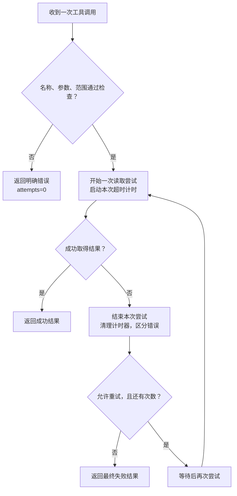

# 第四篇 · 怎样让工具调用可靠地执行？

学习路线：[[00-Agent开发实习学习路线与项目规划]]。上一篇：[[03-build-a-minimal-agent-loop|跑通一个最小 Agent 循环]]。

下一篇：[[05-rag-and-grounded-answers|RAG：怎样让回答有资料依据？]]。

> [!tip] 这篇怎么学
> **先判断错误 → 运行小实验 → 看重试日志 → 理解重复提交 → 改一次尝试上限。** 正文讲行为与取舍，完整代码、语法和接回第三篇的方法放在文末。本篇实验不请求真实模型。

## 1. 循环跑通之后，为什么还需要这一篇？

第三篇已经解决了：**模型提出调用，程序执行工具，再把结果交回去。**

但工具执行时，还可能遇到这些问题：

| 情况          | 你要做的判断              |
| ----------- | ------------------- |
| 路径填成数字 7    | 先拒绝参数，让调用方修正        |
| 文件不存在       | 返回明确原因，不能原样无限重试     |
| 查询服务暂时不可用   | 在允许的次数内，等待后再试       |
| 工具很久不返回     | 到时停止等待，并请求取消支持取消的操作 |
| 提交已成功，但响应丢了 | 先确认重复执行会不会再产生一条记录   |

本篇围绕三个概念：**输入输出约定、有限重试、防止重复执行。** 你不用写通用工具框架，但要能解释遇到不同失败时，程序为什么采取不同动作。

## 2. 先约定：工具接收什么，返回什么？

继续使用第三篇的读取要求：

```json
{
  "id": "call_1",
  "type": "function",
  "function": {
    "name": "read",
    "arguments": "{\"path\":\"lesson.txt\"}"
  }
}
```

它表示：“执行 read，参数里的 path 是 lesson.txt，调用编号为 call_1。”`arguments` 是 JSON 字符串，解析后还要检查内容。

**传给模型的工具参数说明，是告诉它应该怎么填；真正执行前，程序仍要检查收到的值。**

本例只接受 read 工具、一个文字类型的 path，以及 lesson.txt 或 missing.txt 这两个文件名。检查失败时，**一次读取都不执行**。

成功结果采用：

```json
{"ok":true,"text":"实际读到的文字","attempts":1}
```

参数错误时采用：

```json
{
  "ok": false,
  "code": "INVALID_ARGUMENT",
  "error": "只接受一个文字类型的 path 参数",
  "retryable": false,
  "attempts": 0
}
```

| 字段 | 你在本例中怎么看？ |
| --- | --- |
| ok | 工具执行是否成功 |
| text / error | 成功时的文字，或失败时的原因 |
| code | 供程序判断的错误类别，不依赖猜测中文报错 |
| retryable | 这类错误是否允许本执行器原样重试，仍受次数限制 |
| attempts | 已实际开始几次读取尝试；参数被拒绝时为 0 |

这些字段和错误码是**本篇自行约定**的，不是 DeepSeek 或 Pi 自动提供的字段。第三篇用 tool_call_id 对应调用的方式继续保留。

## 3. 超时和重试：先分类，再决定下一步

**超时**是在规定时间内没有取得完成结果。**重试**是失败后再执行一次同样的操作。两者不能直接画等号：先看错误原因，再看重复执行的后果。[超时与重试的工程说明](https://aws.amazon.com/builders-library/timeouts-retries-and-backoff-with-jitter/)

本例仅对**只读工具**采用下面的策略：

| code | 本例代表什么？ | 是否原样重试？ |
| --- | --- | --- |
| INVALID_ARGUMENT / UNKNOWN_TOOL | 参数不符合约定，或工具不存在 | 否，需要修正调用 |
| NOT_ALLOWED | 文件名不在允许范围 | 否，不能靠重试绕过限制 |
| NOT_FOUND | 本次文件不存在 | 否 |
| TEMPORARY | 人为模拟的暂时故障 | 是，但有次数上限 |
| TIMEOUT | 读取未在时限内完成 | 是，本例先请求取消并等操作结束 |
| READ_FAILED | 其他尚未分类的读取错误 | 否，先检查日志 |

本篇教学参数是：**最多尝试 2 次，每次约 300 毫秒超时，两次之间等待 50 毫秒。** 这是为了快速观察，不是实际项目应统一采用的数值。**最多 2 次尝试 = 第一次执行 + 最多 1 次重试。**



> [!important] 超时不代表“什么都没发生”
> 本例使用取消信号，让支持 signal 的读取和模拟等待响应取消。它不是强行终止任意函数；不支持取消的工具，需要单独设计处理方式。即使本地取消了等待，也不能据此认定远程提交已被撤销。[Node.js 读取与取消说明](https://nodejs.org/api/fs.html#fspromisesreadfilepath-options)

## 4. 动手：第一次失败，第二次成功

先展开 [[#附录 A：准备文件与完整代码|附录 A]]，准备 reliable-tools.mjs 和 lesson.txt。然后在练习目录运行：

```powershell
node reliable-tools.mjs ok
node reliable-tools.mjs flaky
```

ok 正常读取；flaky 则**人为安排第一次暂时失败，第二次再真正读取文件**。这个模式是用来验证重试逻辑，不是让本地文件随机出故障。

flaky 模式的日志按以下顺序出现：

| type         | 关键字段                          | 发生了什么？       |
| ------------ | ----------------------------- | ------------ |
| case         | mode=flaky，live=false         | 选择离线实验       |
| tool_attempt | id=call_1，attempt=1           | 第一次尝试        |
| tool_failure | code=TEMPORARY，retryable=true | 失败类型允许重试     |
| retry_wait   | nextAttempt=2，waitMs=50       | 等待 50 毫秒再试   |
| tool_attempt | id=call_1，attempt=2           | 第二次尝试，同一调用编号 |
| tool_success | attempt=2                     | 实际读取成功       |
| tool_result  | result.ok=true，attempts=2     | 返回这次调用的最终结果  |

**这次只有一个 call_1，但内部尝试了两次。** 没有新增模型请求，也不需要生成第二个工具调用编号。若接回第三篇，执行器最终只交回一条 tool 结果消息。

再运行三种失败：

| 命令 | 预期结果 |
| --- | --- |
| `node reliable-tools.mjs bad-args` | INVALID_ARGUMENT，attempts=0，不进行读取 |
| `node reliable-tools.mjs missing` | NOT_FOUND，attempts=1，不重试 |
| `node reliable-tools.mjs slow` | 每次模拟等待 600 毫秒，约 300 毫秒时收到取消；两次后返回 TIMEOUT |

失败实验退出码为 1，是预期行为。slow 的实际耗时还受调度和等待间隔影响，不要求精确等于 600 毫秒。

## 5. 为什么“提交失败就重试”可能多出一条记录？

假设工具不再读取文件，而是提交一条整改记录：

1. 服务端已经生成记录。
2. 返回响应途中出了问题，调用方没收到。
3. 调用方以为没成功，再提交一次。
4. 如果服务端不识别重复请求，就会多出一条记录。

因此，**没收到成功响应，只说明调用方不知道结果，不能证明服务端没有执行。** 解决这个问题的一种常用方法是**幂等性**：同一个业务请求重复发送时，不重复产生那次业务副作用。[重复请求与幂等设计](https://aws.amazon.com/builders-library/making-retries-safe-with-idempotent-APIs/)

在本篇的模拟服务中，同一次提交使用请求键 `submit-001`。服务端首次保存结果；收到同一个键、同样业务参数时，返回已保存的结果。

分别运行：

```powershell
node reliable-tools.mjs unsafe-repeat
node reliable-tools.mjs safe-repeat
```

| 模式 | 第一次 | 同一请求再来一次 | 最后记录数 |
| --- | --- | --- | --- |
| unsafe-repeat | 已提交，模拟响应丢失 | 又创建 record_2 | 2 |
| safe-repeat | 已提交，保存键和结果，模拟响应丢失 | replay，返回原来的 record_1 | 1 |

这里模拟的是**提交成功后响应丢失**，不是制造真实网络超时；记录仅保存在当前进程的数组中。

### 为什么不能直接用 call_1 去重？

“call_1 能直接充当业务去重键吗？”是在问：**能不能用这次工具调用的编号，判断“这笔业务是否已经处理过”，从而避免重复提交？**

通常不能直接这样用，因为两种编号识别的对象不同：

| 编号 | 用来识别什么？ |
| --- | --- |
| **调用编号 call_1** | 模型这一次工具调用，用来对应工具结果 |
| **业务去重键 submit-001** | 用户这一次提交意图，用来避免重复产生业务记录；也常叫“幂等键” |

假设用户要提交一条整改记录，第一次提交已经成功，但返回响应丢失。模型得知没有收到结果后，又提出一次提交调用：

```text
第一次工具调用：call_1
业务请求键：submit-001
→ 服务端创建 record_1，但返回响应丢失。

模型重新提出调用：call_2
业务请求键：仍然是 submit-001
→ 服务端识别出这笔业务已处理，返回 record_1，不再新建。
```

如果服务端只按调用编号去重，看到没见过的 call_2，可能又创建一条记录；按业务请求键检查，才能知道：“submit-001 已经处理过，返回之前的结果即可。”

**同一笔业务重试时，工具调用编号可能变化，但业务去重键应保持一致。** 新的业务请求使用新键；同一键却改了业务参数，应拒绝而不是默默复用。

这里演示的是**模型重新提出一次调用**。**第 4 节那种工具执行器内部重试，可以始终沿用 call_1；两种情况不要混淆。** 本篇提交脚本不调用模型，上面用 call_1、call_2 说明接入模型后的业务情形。

> [!info]- 本例的幂等演示能证明什么？
> 仅演示单进程内、顺序调用时的重复识别。重启后数据会消失，也没有解决并发重复提交。真实服务还需要按用户和业务限定请求键范围、核对参数，并让业务写入与请求键记录可靠地一起完成。只有客户端记一个编号，不足以保证服务端不重复写入。[服务端幂等处理](https://aws.amazon.com/builders-library/making-retries-safe-with-idempotent-APIs/)

## 6. 亲手改一次：把最多尝试次数改成 1

在完整代码中找到：

```javascript
maxAttempts = 2
```

改为 1，保存后重新运行：

```powershell
node reliable-tools.mjs flaky
```

先预测，再对照日志：**第一次仍会 TEMPORARY 失败，但没有第二次尝试，最终结果 ok=false、attempts=1。** retryable 仍为 true，表示这种错误可以按策略考虑重试；本次预算已用完，所以实际停止。实验后恢复默认值 2。

| 限制 | 限制什么？ |
| --- | --- |
| 第三篇 maxSteps | 最多请求模型几次，最终回答也计数 |
| 本篇 maxAttempts | 一次工具调用内部，最多尝试执行几次 |
| 本篇 timeoutMs | 单次读取尝试的超时阈值 |
| 本篇 waitMs | 两次尝试之间等待多久 |

它们不是同一个限制。若工具重试后失败，模型又提出新调用，还会产生另一轮工具执行；项目中还需整体控制总调用量与总耗时。

## 7. 合上笔记，检查这五个判断

1. 已给模型参数规则，为什么执行前还要检查？
2. 为什么文件不存在，不按本例策略重试？
3. 最多尝试 2 次，是重试 2 次吗？
4. 提交工具超时，能认定提交没发生吗？
5. call_1 能直接充当业务去重键吗？

> [!faq]- 参考答案
> 1. 模型提供的实际值仍可能不符合要求；程序要检查类型、必填项与允许范围，才能执行。
> 2. 原样重复本次调用不会解决缺失问题，应返回 NOT_FOUND，让调用方核对路径或资料。本例按此策略处理，不代表所有业务永远禁止重查。
> 3. 不是。包含第一次执行，所以最多只重试 1 次。
> 4. 不能。可能尚未执行，也可能已成功但响应丢失。要查询业务状态，或使用服务端支持的幂等机制。
> 5. 不能直接等同。它对应消息；同一业务重试可能有新调用编号，需要独立标识业务意图的请求键。具体例子见 [[#为什么不能直接用 call_1 去重？|调用编号与业务去重键的区别]]。

做到能根据日志判断“参数被拒绝、读取失败、暂时失败、超时、重复提交”，并验证一次次数修改，就可以把这些规则用到候选项目。

先用**只读业务查询**替换教学读取，保留少量固定样例。区分“查询成功但没有记录”和“查询服务失败”；有写入需求后，再增加确认、权限和业务幂等机制。文档检索、长期记忆等模块按项目问题逐步补，不必一次加入全部能力。

---

## 附录 A：准备文件与完整代码

> [!example]- 准备环境与练习文件
> 沿用第三篇的 Node.js 22 或更新版本。在练习目录中保留 lesson.txt，新增 reliable-tools.mjs，把下方完整代码复制进去；不要覆盖 mini-agent.mjs。
>
> ```text
> 练习目录/
>   lesson.txt
>   mini-agent.mjs        第三篇已有
>   reliable-tools.mjs    本篇新增
> ```
>
> lesson.txt 可以保留你原来的普通文字，例如：
>
> ```text
> 今天学习 Agent。模型提出工具调用，程序执行工具。
> ```
>
> 不创建 missing.txt。如果已经存在，换一个干净的练习目录来运行缺失文件实验。无需安装 npm 包，也不需要 API 密钥。`.mjs` 的解释见 [[03-build-a-minimal-agent-loop#附录 A：准备文件与完整代码|第三篇附录 A]]。
>
> 在练习目录的 PowerShell 中运行正文命令。只读实验实际访问教学文件；暂时故障、慢响应与提交服务由程序人为模拟。重复提交实验只改当前进程中的数组，不写业务记录到磁盘，不连接真实服务。

> [!example]- 完整代码：保存为 reliable-tools.mjs
> ```javascript
> import { readFile } from "node:fs/promises";
> import { setTimeout as sleep } from "node:timers/promises";
> import { resolve } from "node:path";
> import { fileURLToPath } from "node:url";
>
> function problem(code, message) {
>   return Object.assign(new Error(message), { code });
> }
>
> function validateCall(call) {
>   if (call?.function?.name !== "read") {
>     throw problem("UNKNOWN_TOOL", "只支持 read 工具");
>   }
>   let args;
>   try { args = JSON.parse(call.function.arguments); }
>   catch { throw problem("INVALID_ARGUMENT", "参数不是合法 JSON"); }
>   if (!args || typeof args !== "object" || Array.isArray(args) ||
>       typeof args.path !== "string" || Object.keys(args).length !== 1) {
>     throw problem("INVALID_ARGUMENT", "只接受一个文字类型的 path 参数");
>   }
>   if (!["lesson.txt", "missing.txt"].includes(args.path)) {
>     throw problem("NOT_ALLOWED", "仅允许 lesson.txt 或 missing.txt");
>   }
>   return args;
> }
>
> function classify(error, signal) {
>   if (signal.aborted) return { code: "TIMEOUT", error: "读取超时", retryable: true };
>   if (error.code === "EAGAIN") {
>     return { code: "TEMPORARY", error: "模拟服务暂时不可用", retryable: true };
>   }
>   if (error.code === "ENOENT") {
>     return { code: "NOT_FOUND", error: "文件不存在", retryable: false };
>   }
>   return { code: "READ_FAILED", error: "读取失败，请检查工具日志", retryable: false };
> }
>
> export async function executeRead(call, {
>   maxAttempts = 2, timeoutMs = 300, waitMs = 50, log = () => {},
>   readText = (path, { signal }) =>
>     readFile(new URL(path, import.meta.url), { encoding: "utf8", signal }),
> } = {}) {
>   if (!Number.isInteger(maxAttempts) || maxAttempts < 1 ||
>       !Number.isFinite(timeoutMs) || timeoutMs <= 0 ||
>       !Number.isFinite(waitMs) || waitMs < 0) {
>     throw new Error("执行器配置无效");
>   }
>   let args;
>   try { args = validateCall(call); }
>   catch (error) {
>     const result = {
>       ok: false, code: error.code, error: error.message,
>       retryable: false, attempts: 0,
>     };
>     log({ type: "tool_rejected", id: call?.id, code: result.code });
>     return result;
>   }
>
>   for (let attempt = 1; attempt <= maxAttempts; attempt++) {
>     log({ type: "tool_attempt", id: call.id, attempt });
>     const controller = new AbortController();
>     const timer = setTimeout(() => controller.abort(), timeoutMs);
>     let failure;
>     try {
>       const text = await readText(args.path, { signal: controller.signal });
>       if (controller.signal.aborted) throw new Error("已收到取消信号");
>       log({ type: "tool_success", id: call.id, attempt });
>       return { ok: true, text, attempts: attempt };
>     } catch (error) {
>       failure = classify(error, controller.signal);
>     } finally {
>       clearTimeout(timer);
>     }
>     log({ type: "tool_failure", id: call.id, attempt,
>       code: failure.code, retryable: failure.retryable });
>     if (!failure.retryable || attempt === maxAttempts) {
>       return { ok: false, ...failure, attempts: attempt };
>     }
>     log({ type: "retry_wait", id: call.id,
>       nextAttempt: attempt + 1, waitMs });
>     await sleep(waitMs);
>   }
> }
>
> // 仅模拟当前进程中的顺序提交，不连接业务系统或写入文件。
> export function createSubmissionService({ dedupe = true, log = () => {} } = {}) {
>   const records = [];
>   const saved = new Map();
>   function submit(requestId, projectId, { loseReply = false } = {}) {
>     if (dedupe && saved.has(requestId)) {
>       const previous = saved.get(requestId);
>       if (previous.projectId !== projectId) {
>         throw problem("IDEMPOTENCY_CONFLICT", "同一请求键不能改成另一项业务");
>       }
>       log({ type: "replay", requestId, recordId: previous.record.id });
>       return previous.record;
>     }
>     const record = { id: "record_" + (records.length + 1), projectId };
>     records.push(record);
>     if (dedupe) saved.set(requestId, { projectId, record });
>     log({ type: "submitted", requestId, recordId: record.id });
>     if (loseReply) throw problem("RESPONSE_LOST", "已提交，但模拟返回响应丢失");
>     return record;
>   }
>   return { submit, records };
> }
>
> async function main() {
>   const mode = process.argv[2] ?? "ok";
>   const modes = ["ok", "bad-args", "missing", "flaky", "slow",
>     "always-fail", "unsafe-repeat", "safe-repeat"];
>   if (!modes.includes(mode)) throw new Error("未知实验模式");
>   const log = (event) => console.log(JSON.stringify(event));
>   log({ type: "case", mode, live: false });
>
>   if (mode === "unsafe-repeat" || mode === "safe-repeat") {
>     const service = createSubmissionService({
>       dedupe: mode === "safe-repeat", log,
>     });
>     try {
>       service.submit("submit-001", "project-A", { loseReply: true });
>     } catch (error) {
>       log({ type: "client_error", code: error.code });
>     }
>     const record = service.submit("submit-001", "project-A");
>     log({ type: "submit_end", recordId: record.id,
>       recordCount: service.records.length });
>     return;
>   }
>
>   const call = { id: "call_1", type: "function", function: {
>     name: "read",
>     arguments: JSON.stringify({
>       path: mode === "bad-args" ? 7 :
>         mode === "missing" ? "missing.txt" : "lesson.txt",
>     }),
>   } };
>   let reads = 0;
>   const readText = async (path, { signal }) => {
>     reads++;
>     if ((mode === "flaky" && reads === 1) || mode === "always-fail") {
>       throw problem("EAGAIN", "人为安排的暂时故障");
>     }
>     if (mode === "slow") await sleep(600, undefined, { signal });
>     return readFile(new URL(path, import.meta.url), { encoding: "utf8", signal });
>   };
>   const result = await executeRead(call, { readText, log });
>   log({ type: "tool_result", id: call.id, result });
>   if (!result.ok) process.exitCode = 1;
> }
>
> if (process.argv[1] && resolve(process.argv[1]) === fileURLToPath(import.meta.url)) {
>   main().catch((error) => { console.error(error.message); process.exitCode = 1; });
> }
> ```

复制后回到 [[#4. 动手：第一次失败，第二次成功|第 4 节]]。下面是额外的持续失败实验：

```powershell
node reliable-tools.mjs always-fail
```

它每次都模拟暂时失败；最多两次后返回 TEMPORARY，attempts=2，不再继续等待和重试。

## 附录 B：用到再查的写法

> [!info]- 关键变量、取消信号与新语法
>
> | 写法 | 本例中的用途 |
> | --- | --- |
> | maxAttempts | 执行策略的上限 |
> | attempt | 当前正在尝试第几次，用于日志 |
> | result.attempts | 最后实际尝试了几次；参数拒绝时为 0 |
> | AbortController / signal | 发出取消信号，由读取函数或等待函数响应 |
> | setTimeout / clearTimeout | 设置本次尝试的计时器；结束后清理，避免影响后续步骤 |
> | await sleep(waitMs) | 两次尝试间让出等待时间，不立即重复请求 |
> | finally | 成功或失败都会执行这里的计时器清理 |
> | ...failure | 把错误类别、文字与可重试标记放入结果对象 |
> | new Map() | 模拟服务按请求键保存参数与记录 |
>
> 本篇固定等待 50 毫秒，便于复现实验。实际远程服务可按要求使用逐渐增加的等待时间、随机分散重试时间，并遵守服务端建议；不要把所有请求都立即重试。[重试与等待策略](https://aws.amazon.com/builders-library/timeouts-retries-and-backoff-with-jitter/)
>
> 取消需要被调用函数配合；Node.js readFile 与本例使用的可取消等待支持 signal。取消 readFile 不保证中止每一个底层系统请求。[读取 API](https://nodejs.org/api/fs.html#fspromisesreadfilepath-options)、[可取消等待](https://nodejs.org/api/timers.html#timerspromisessettimeoutdelay-value-options)

## 附录 C：理解后，再接回第三篇

> [!example]- 可选：替换第三篇的工具执行器
> 先完成独立实验，理解行为后再接回第三篇；下面是可选修改，不是运行本篇的前提。
>
> **① 在 mini-agent.mjs 顶部引入新执行器，并移除原来的同名 executeRead 函数定义。** 两个文件放在同一目录：
>
> ```javascript
> import { executeRead } from "./reliable-tools.mjs";
> ```
>
> **② 在 runAgent 的默认参数中，让读取函数接收并传递取消信号：**
>
> ```javascript
> readText = (path, { signal }) =>
>   readFile(new URL(path, import.meta.url), { encoding: "utf8", signal }),
> ```
>
> 这替换原来只接收 path、使用 "utf8" 字符串选项的那一行。忽略 signal 的旧函数不能及时响应这里的取消请求。
>
> **③ 把原来的调用改成以下形式：**
>
> ```javascript
> const result = await executeRead(call, {
>   readText,
>   log,
> });
> ```
>
> 工具结果仍按原方式加入 messages：
>
> ```javascript
> messages.push({
>   role: "tool",
>   tool_call_id: call.id,
>   content: JSON.stringify(result),
> });
> ```
>
> 本篇保留了成功时的 text 与失败时的 error 文字，第三篇模拟函数仍能据此生成回答。新增的 code、retryable、attempts 供程序和日志区分失败原因。
>
> 这里处理的是**工具执行层**。第三篇原有的模型请求失败仍由 runAgent 处理，不会因为接入本执行器就自动重试模型 API。一个工具调用在内部尝试结束后，只回传一条最终工具结果；期间不需要再次请求模型。

## 附录 D：验证范围与暂缓内容

> [!info]- 本篇验证了什么？
> 2026-11-10，使用 Node.js v25.9.0，在临时目录验证了 16 个离线场景与分支：8 种命令模式、maxAttempts 为 1、3 种调用校验分支、取消后再重试、幂等重放与参数冲突，以及接回第三篇循环的 2 种情况。
>
> 正常与 flaky 模式读取真实教学文件；暂时故障、慢响应、业务提交与响应丢失由本地程序模拟。未调用真实模型、业务 API，也未读取真实密钥。示例只允许两个教学文件名，不构成完整沙箱。

当前不需要实现通用重试框架、持久化幂等服务、分布式锁或多 Agent 调度。后续在项目中遇到具体问题，再查实现细节并用固定测试验证。

资料核对日期：2026-11-10。本文工具结果和日志格式为教学约定；官方资料用于核对文件读取、取消、重试和幂等性机制。
